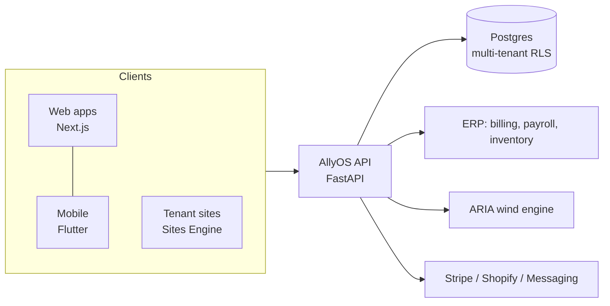

# Chris Bergler: Product & Engineering Portfolio

Platforms, tools and data products I design and build end to end. Source is private. This repo shows **what each project is, how it is built, and how big it is**.

> Open to: licensing, acquisition conversations, consulting and senior engineering roles. Contact: [antigravityalliance.com](https://antigravityalliance.com) · [dev@allyos.app](mailto:dev@allyos.app) · +27 76 931 7108

Each product serves a different clientele and is presented on its own page. They share one platform underneath.

| Product | Built for | What it is | Core stack | Size |
|---|---|---|---|---|
| [AllyOS](projects/allyos) | Schools and operators | The operations platform: scheduling, bookings, change handling between owner, instructor and client, widget, mobile | FastAPI, Postgres, Next.js | ~380k LOC |
| [AllyOS Booking Engine](projects/allyos-booking) | Schools and operators | The booking and scheduling engine in depth | FastAPI, Next.js, Flutter | ~340k LOC |
| [AllyOS ERP](projects/allyos-erp) | Brands, factories, distributors, shops | Industry-specific ERP: whole-chain gear tracking, multi-party settlement, path to direct-to-consumer | FastAPI, Postgres, Stripe Connect | ~39k LOC + ~14k tests |
| [ARIA](projects/aria) | Riders, schools, platforms | Calibrated, probabilistic wind forecasts per spot | Python, NWP/GRIB, Postgres | ~5k LOC + tests |
| [Association Platform](projects/allyos-association) | Clubs, associations, federations | Membership, badges, bilingual public site, revenue shares | Next.js 16, pnpm + Turborepo | ~11k LOC |
| [United Gear](projects/united-gear) | A gear brand and its riders | Direct-to-rider storefront with configurators | Next.js 16, Tailwind 4 | ~16k LOC |
| [Sites Engine + Connect](projects/sites-engine-connect) | Platforms, schools, shops | Branded tenant sites from configuration and a shared directory layer | TypeScript packages | ~11k LOC |
| [SoftWing](projects/softwing) | Kite and wing designers | Parametric soft-wing design software | .NET 8, Rhino, web editor | ~22k LOC |
| [BizCockpit](projects/bizcockpit) | Small-business owners | Local-first business dashboard | TypeScript, SQLite, Electron, Docker | ~12k LOC |

Sizes are generated by [`scripts/stats.sh`](scripts/stats.sh): tracked source files only, excluding lockfiles, vendored code, generated output and markdown/JSON. Last run: 2026-10-13.

## Shared architecture

