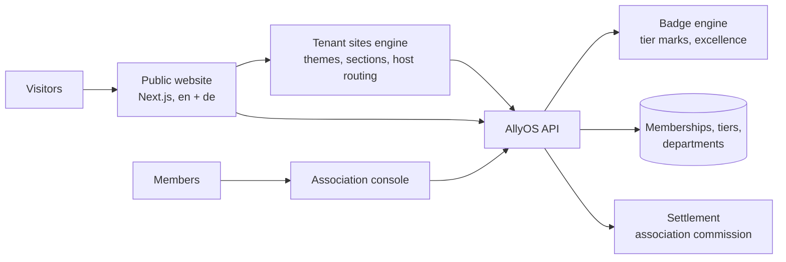
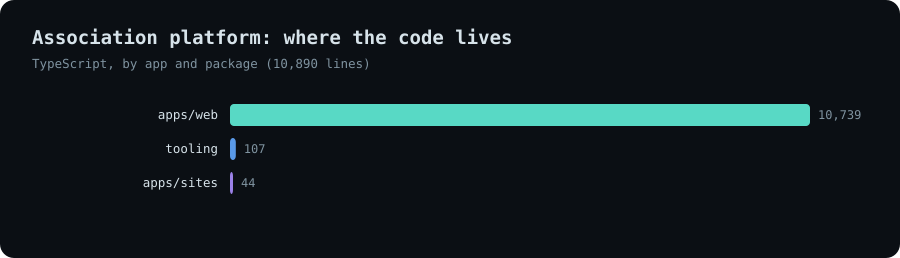
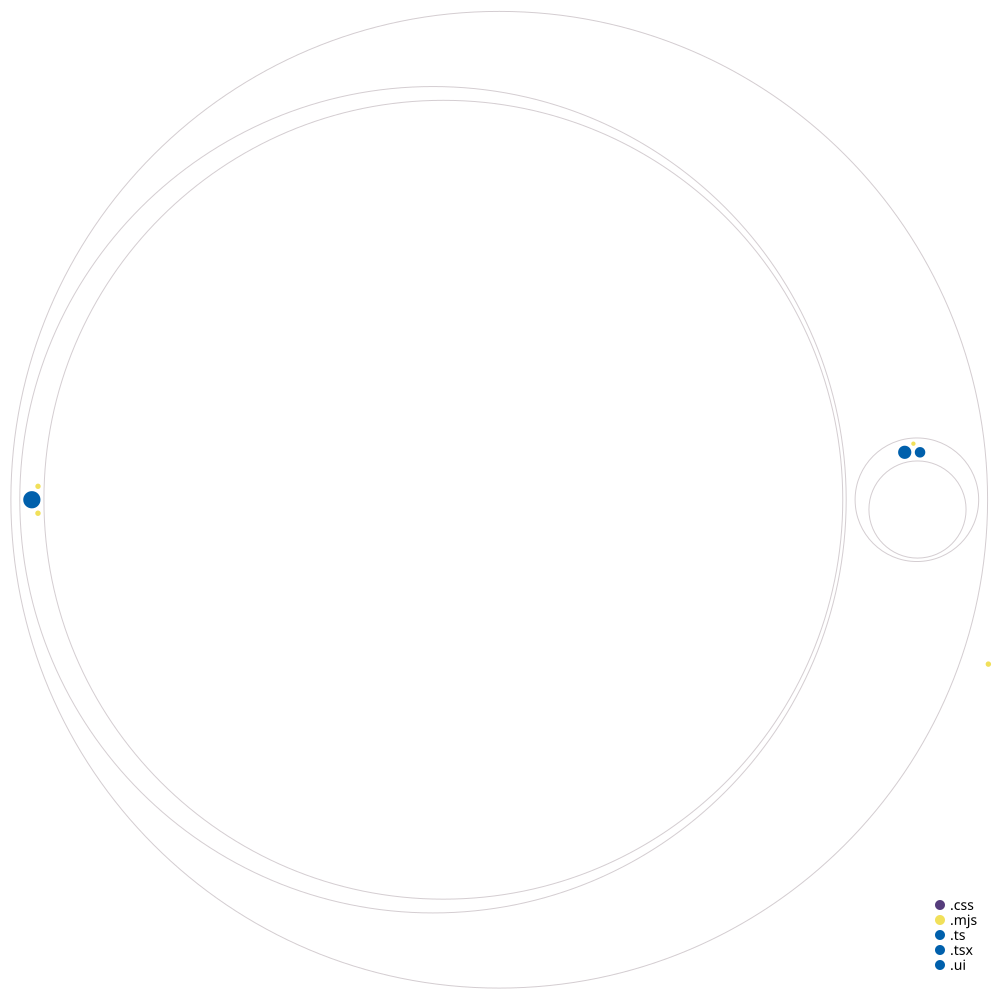

# Association Platform

**The operating system for a watersports association: members, schools and instructors under one governed body, a bilingual public website, verifiable badges, and revenue shares that flow back to the association.**

*Source is private. This page documents the product and how it is built.*

---

## The product

<!-- TODO: replace with real captures of the live pilot site and the console -->
| Home | Directory of schools | Certification pathways |
|---|---|---|
| _screenshot_ | _screenshot_ | _screenshot_ |

| Badge and verify page | Spot league | Association console |
|---|---|---|
| _screenshot_ | _screenshot_ | _screenshot_ |

---

## What it is

An association is a different thing from a school. A school runs lessons; an association governs the schools, instructors and riders that belong to it. The positioning in one line: **the school platform runs the school; the association platform runs the club the schools belong to.**

**Who it is for**

| You are | What you get |
|---|---|
| **An association, club or federation** | A public website that doubles as a directory, a member console, certifications and badges, and a share of the revenue your members' sales generate. |
| **A member school or instructor** | A public profile that search engines and AI search can read, career and contract pages, verifiable accreditation badges, and the booking platform behind it. |
| **A rider** | A directory of schools and spots, jobs and gigs, and a way to check that an instructor's credentials are real. |
| **A brand** | A channel into the association's schools, with the association's commission handled automatically at settlement. |

**The structural idea.** Membership is a many-to-many link between an association and an existing entity on the platform (a school, an instructor or a rider), carrying a tier, dues, insurance and a status. Everything else hangs off that link, which is why a second association is a new row and not a new system.

---

## Architecture

<picture>
  <source media="(prefers-color-scheme: dark)" srcset="../../assets/allyos-association/architecture-dark.svg">
  
</picture>

[Open the interactive diagram](../../assets/allyos-association/architecture.html)

---

## Stack

| Layer | Technology | Why |
|---|---|---|
| Web | Next.js 16 (App Router), React 19, TypeScript | Server rendering for the public site, strict types |
| Styling | Tailwind CSS 4 with an editorial design system | Consistent look, quick theming |
| Languages | next-intl, English and German, 1,700+ message keys | The association operates in two languages from day one |
| Validation | Zod | One schema language for API data |
| Maps | Mapbox GL | Spot and directory maps |
| Monorepo | pnpm workspaces, Turborepo | Web app, tenant-sites app and shared engine build together |
| Tenant sites | Shared sites engine (themes, sections, host routing) | Each member school can get its own branded site from configuration |
| Backend | The AllyOS platform (FastAPI, Postgres, row-level security) | Shared identity, payments, settlement and audit |
| Delivery | GitHub Actions, Vercel | Typecheck, test, translation check and build on every change |

---

## How it is engineered

**A truth map for the public site.** The build plan classifies every feature as live, partial or planned, and the site markets only what is live. Anything else is labelled as coming soon. The people being recruited are professionals who notice overstatement, so the rule is part of the process.

**Translations are checked, not hoped for.** A parity gate fails the build if the English and German files do not have exactly the same set of keys, because a missing key would break rendering.

**A live directory behind a static-feeling site.** School, instructor, job and spot pages read from the platform's public API, with server rendering so both search engines and AI search can read them.

**One engine, many branded sites.** The tenant-sites app resolves a host to a tenant and renders it from the shared engine, so each member school or partner gets its own look from configuration.

**Accreditation that can be verified.** Badge marks come in two kinds. Tier marks (member, trusted, academy and similar) are set by platform admins or derived from the owner's subscription. Yearly excellence badges are composites of weighted sub-criteria (business, experience, gear, instructor quality). Each criterion scores 0 to 1; criteria without enough data are dropped and the weights renormalised, so a school is never penalised for data that does not exist. The public verify page is the entry point for checking a badge; the identifier lookup is the next step.

**Revenue shares as first-class settlement lines.** A sale can pay several associations, each at its own configurable rate, globally or per brand. Association payouts are recorded as separate lines in the settlement ledger and held until the association has a payout account, so live settlements are unchanged until it is switched on.

**Security and privacy by design.** Member data lives behind the platform's tenant isolation. The design requires SEPA direct-debit mandates and consent-aware communication from the start (GDPR purpose and withdrawal tracking), and treats these as non-negotiable for the first release.

---

## Key design decisions

| Decision | Trade-off |
|---|---|
| The association is a top-level tenant type, a sibling of the school, not a subtype | One more role to build, but the school product is untouched and several associations can coexist |
| Membership as a polymorphic link to existing entities | A little more modelling, but a school can belong to more than one association and nothing duplicates identity |
| Build inside the existing production frontend as a new role | Reuses auth, payments, notifications and audit instead of a second app |
| Phase the console: members and structure first, money and governance next | Ships value earlier, with unfinished tabs clearly marked in the product |
| Association commission defaults to nothing | No behaviour changes for existing sales until rates are configured |

---

## Build status

| Area | Progress | |
|---|---|---|
| Public association website (36 routes, en + de) | `▰▰▰▰▰▰▰▰▱▱` 80% | Live directory, jobs, spots, certification pages |
| Tenant sites engine | `▰▰▰▰▰▰▰▰▱▱` 80% | Shared with other brands' sites |
| Badges and verification | `▰▰▰▰▰▱▱▱▱▱` 55% | Scoring engine, scheduler and tests built; the public verify lookup is next |
| Association commission in settlement | `▰▰▰▰▰▰▱▱▱▱` 60% | Rates and ledger lines built; payouts wait for association accounts |
| Association console | `▰▰▰▱▱▱▱▱▱▱` 35% | Members, overview, structure, certifications; later tabs marked |
| Membership model and tiers | `▰▱▱▱▱▱▱▱▱▱` 15% | Architecture complete; data model in build |
| Dues and SEPA direct debit | `▰▱▱▱▱▱▱▱▱▱` 5% | Designed |
| Insurance packages | `▰▱▱▱▱▱▱▱▱▱` 5% | Designed |
| Governance and arbitration | `▰▱▱▱▱▱▱▱▱▱` 10% | Designed, console shell started |
| Member communications | `▰▱▱▱▱▱▱▱▱▱` 5% | Designed, consent model specified |

*Percentages are estimates against the intended scope. The associated architecture documents cover the full design.*

---

## Size and structure

| Part | Files | Lines of code |
|---|---|---|
| Public website and tenant sites (TypeScript) | 168 | ~11k |
| Association console (in the platform frontend) | 17 | ~1k |
| Badge engine, scheduler and tests (backend) | 4 | ~1.2k |
| Architecture and build documents | 3 | ~0.5k |

| Where the code lives | Structure map |
|---|---|
|  |  |

*Structure map: circle size is file size, colour is file type. Folder and file names only.*

---

## Status

Active development. Open to licensing, partnership with other associations, and consulting.

**Contact:** [antigravityalliance.com](https://antigravityalliance.com) · [dev@allyos.app](mailto:dev@allyos.app) · +27 76 931 7108
