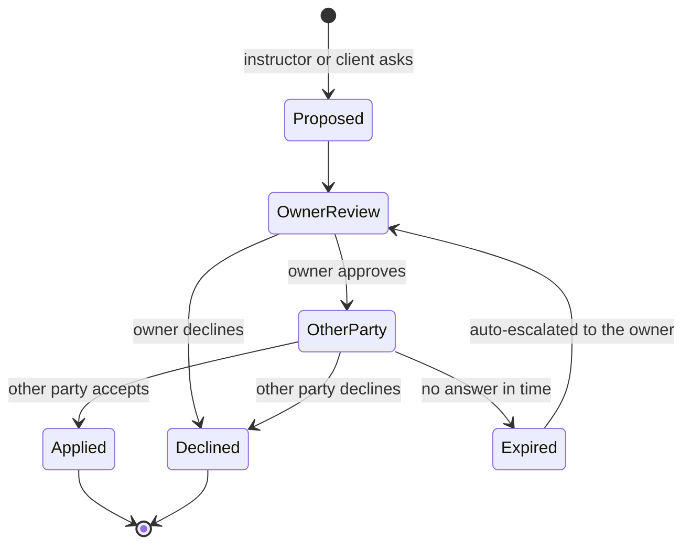
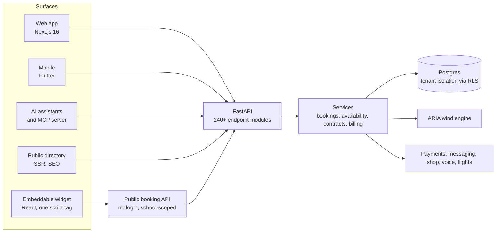
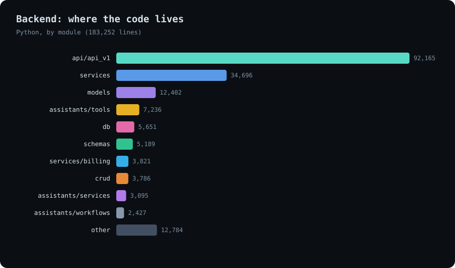
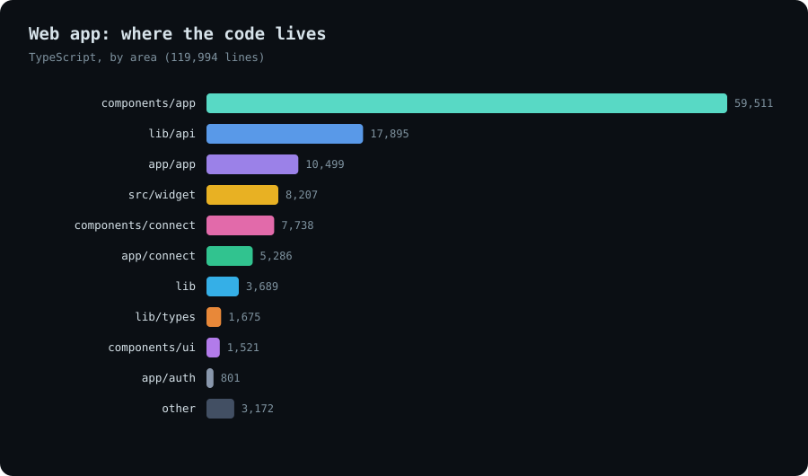
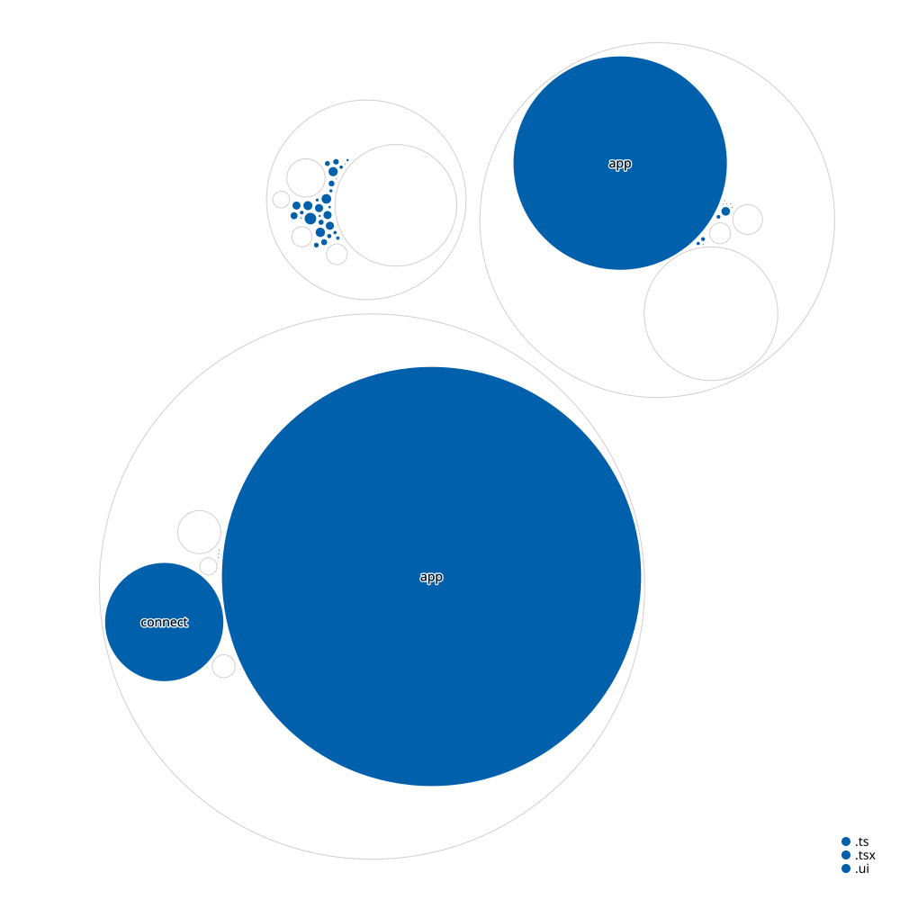

# AllyOS Booking Engine

**One multi-tenant platform for booking, running and growing a water-sports school: web app, embeddable widget, public directory, AI assistants, API and mobile.**

*Source is private. This page documents the product and how it is engineered.*

---

## The product

<!-- TODO: replace with real, anonymised captures (blur personal data) -->
| Booking flow | Embedded widget | School dashboard |
|---|---|---|
| _screenshot_ | _screenshot_ | _screenshot_ |

| Owner's scheduler | Change-request dialog | Client hub |
|---|---|---|
| _screenshot_ | _screenshot_ | _screenshot_ |

| Instructor's day | Client's lessons | Mobile app |
|---|---|---|
| _screenshot_ | _screenshot_ | _screenshot_ |

**White-label by design.** One deployment serves many hosts. Each school gets its own name, logo and colour tokens, so the same engine appears in the provider's own look.

---

## What it is

A school or operator runs its whole day on one system, and riders find and book it from anywhere.

**For schools and operators**
- Service catalogue with pricing rules and blackout dates, availability rules and exceptions, slot search, group lessons with participants, add-ons and deposits, and a drag-and-drop scheduler.
- Instructors: profiles, schedules, contracts, income and conditions.
- Waivers signed electronically, reviews and ratings, referral links, notifications.
- Inventory and retail; finance, payroll and reports through the [ERP](../allyos-erp).
- AI assistants for the admin, instructor and finance roles (below).

**For riders and students**
- Search spots and schools, see calibrated live wind and a 10-day forecast ([ARIA](../aria)), book and pay.
- A rider area with gear, progression and earnings; a gear garage with each unit's history.
- Travel and learning assistants.

**For the open web**
- A public directory of schools, instructors, spots, shops, brands, jobs and regions with server-rendered, SEO-friendly pages and a machine-readable site summary for AI search.

---

## The hard part: staying coherent when things change

Anyone can build a calendar. The difficult product is the one where a change by one person is understood, agreed and communicated to the other two without phone tag. AllyOS treats change as the main case.

- **A two-gate change request.** Reschedules, cancellations and new-session proposals flow through the owner first and then the other party. The owner can start a change, the instructor can propose the next session, the client can ask to cancel, and each is routed to whoever has to agree.
- **Nobody is left hanging.** A background job checks every minute for requests and offers that have timed out, then escalates to the owner or marks them expired.
- **The message goes where people read it.** A schedule update can be sent in the app, by email, by SMS (each school can configure its own SMS gateway) and by WhatsApp, as either "accept or decline" or "just acknowledge", singly or in bulk, with a status panel showing who has replied. A non-responder can be nudged by SMS, WhatsApp or a call.
- **Recipients come from the role graph.** Every booking state change emits a notification event, resolves who should receive it (owner, instructor, client) and persists it, so the in-app inbox, the "my day" and "my lessons" views and the audit trail agree.
- **Freed slots are re-sold automatically.** When a booking is cancelled or rejected, a waitlist engine matches eligible entries by instructor, date window, time window, duration, lesson type and spot, ranks them, offers the slot to the best match, and respects a per-slot offer limit.
- **Two ways to book.** In *sharp* mode the client picks exact dates. In *flexible* mode the client says "I am in town from the 3rd to the 10th" and the school later places the lessons on the best days, using the conditions. The window is validated against the service so it is neither too small to fit nor too large to plan.
- **Policy as configuration.** A school builds its cancellation policy from four dimensions (cancellation window, refund tiers, rescheduling, and what happens when weather cancels), each at four strictness levels, and the product generates the readable policy text from the choices.
- **Transport and trips.** Assigning a driver triggers a coordinated message: the client gets driver, vehicle, meeting point and an escalation path by email, SMS and WhatsApp, and the driver gets the pickup details.

---

## Architecture

<picture>
  <source media="(prefers-color-scheme: dark)" srcset="../../assets/allyos-booking/architecture-dark.svg">
  
</picture>

[Open the interactive diagram](../../assets/allyos-booking/architecture.html) (pan, zoom, trace paths).

---

## Stack

| Layer | Technology | Why |
|---|---|---|
| API | Python, FastAPI, Pydantic | Typed contracts, automatic OpenAPI, async I/O |
| Data | Postgres (managed), SQLAlchemy, Alembic | Relational integrity for money and availability; versioned migrations |
| Tenancy | Postgres row-level security | Isolation enforced by the database, not by remembering a filter |
| Web | Next.js 16 (App Router), React 19, TypeScript 6, Tailwind 4 | Server rendering for public pages, strict types end to end |
| Client data | TanStack Query, React Hook Form, Zod | Cached server state, validated forms, one schema language |
| Maps | Mapbox GL | Spot and directory maps |
| Widget | React + TypeScript bundled with Vite into one script | Same components as the app, shipped as a single versioned file |
| Mobile | Flutter (Dart) | One codebase for iOS and Android |
| AI | Anthropic provider behind an interface, role-based assistants, MCP server, voice agents | Assistants that act on real data, with audit and safety gates |
| Payments and messaging | Stripe, SMS and voice provider, flight search | Webhook-driven flows |
| Quality | Pytest, Vitest, Playwright, ESLint, commitlint | Tests at three levels and gated merges |
| Delivery | Docker, GitHub Actions, Vercel, Sentry | Reproducible start, preview deploys, error monitoring |

---

## How it is engineered

**Multi-tenancy by design.** Every business row carries a tenant. Isolation is enforced in Postgres with row-level security, with a written design for tenant-scoped uploads as well.

**Contract first.** The API publishes an OpenAPI contract and the frontend checks its generated types for freshness in CI. Request and response schemas (52 modules) are separate from the 155 persistence models.

**Migrations are the source of truth.** 153 migrations, applied in order, plus CI guards that fail on duplicate revisions or a branched history.

**An AI layer built like a service, not a demo.** Role-based assistants call typed, audited, tenant-scoped tools from the app, WhatsApp, Telegram, voice, any MCP client and a scheduler, with confirmation gates on every write. See the [assistants and MCP architecture note](../allyos/assistants-and-mcp.md) for the runtime, safety model and MCP server.

**A widget that behaves like a product.** The embeddable booking script is versioned. Dedicated checks guard its cache policy, release readiness and source parity before it ships, and source maps are uploaded privately.

**Tested at three levels.** 158 backend test files, 58 frontend unit and end-to-end files, plus offline checks for money paths.

**Merge gates.** Backend CI runs the full test suite, checks the migration tree, checks the app boots, and fails if the published weather schema drifts from the code. Frontend CI runs lint, typecheck, a generated-types freshness check and tests, plus end-to-end runs, dependency audit, secret scanning, bundle-size budgets and commit-message linting.

**Built for search and for AI search.** Public pages are server rendered with sitemaps and robots rules, and the site publishes a machine-readable summary file for AI crawlers.

---

## Key design decisions

| Decision | Trade-off |
|---|---|
| One platform with several surfaces (web, widget, directory, mobile, assistants) | More up-front modelling, but one source of truth for availability and pricing |
| Tenant isolation in the database | Slightly more setup per query, but a missed filter can no longer leak data |
| Widget as its own React bundle with a dedicated no-login API surface | Extra build target, but schools embed it without inheriting the app's weight or auth; versioned URLs keep old embeds working |
| Assistants act through typed tools with audit and safety gates, not free-form access | More engineering per capability, but every action is attributable |
| Weather as a separate engine (ARIA) | Forecast logic evolves on its own cadence without touching booking code |
| Services engine first, trips and multi-day travel as a planned extension | Ships what schools need today; the model leaves room for multi-client, multi-day bookings |

---

## How it evolved

1. **Prototype series.** Eight numbered interactive prototypes explored the flow: single booking, multi-booking, premium layout, full widget flow.
2. **Embedded widget.** The learnings became a school-scoped public API and a standalone embeddable build.
3. **Services engine.** Single-day lessons, group sessions, availability and an audit trail inside the multi-tenant backend.
4. **Assistants and public directory.** Role-based AI assistants, an MCP server, and an SEO-first directory around the same data.
5. **Excursions and transport.** Boats, vehicles, driver shifts and coordinated notifications.
6. **Travel packages (planned).** An architecture brief extends the engine to multi-day, multi-client trips.

---

## Build status

| Area | Progress | |
|---|---|---|
| Booking core (services, availability, slots, state machine) | `▰▰▰▰▰▰▰▰▰▱` 90% | Built and tested |
| Embeddable widget | `▰▰▰▰▰▰▰▰▱▱` 85% | Versioned, release-checked |
| School operations (contracts, waivers, instructors, inventory) | `▰▰▰▰▰▰▰▰▱▱` 80% | Broad feature set |
| Public directory and SEO | `▰▰▰▰▰▰▰▰▱▱` 80% | Server rendered, sitemaps |
| AI assistants and MCP server | `▰▰▰▰▰▰▰▱▱▱` 70% | Roles, tools, workflows, audit built; more tools coming |
| Mobile app | `▰▰▰▰▰▰▱▱▱▱` 60% | Core flows |
| Excursions, transport hub and trip assets | `▰▰▰▰▰▰▱▱▱▱` 60% | Boats, vehicles, drivers, shifts and notification fan-out built |
| Multi-day, multi-client travel packages | `▰▰▱▱▱▱▱▱▱▱` 20% | Architecture brief written |

*Percentages are estimates against the intended scope.*

---

## Security and compliance

**Controls in place**
- **Tenant isolation** enforced in the database with row-level security.
- **Secrets:** no credentials in code, tokens encrypted at rest, API keys stored only as hashes, signed webhooks, a rotation checklist.
- **Audit trail:** audit-log records, a booking audit trail, an assistant audit service and append-only event ledgers.
- **Change control:** CI on every change, linted commits, automated code review, versioned migrations; the web app also runs secret scanning and dependency audits.
- **Public surface:** anonymous endpoints are rate-limited and scoped; assistant and MCP calls are rate-limited and audited.

**Compliance roadmap.** SOC 2 certification has not been started.

| Step | Progress | |
|---|---|---|
| Technical controls (isolation, secrets, audit trail, change control) | `▰▰▰▰▰▰▰▱▱▱` 70% | In place, see list above |
| Written security policies | `▰▱▱▱▱▱▱▱▱▱` 10% | Planned |
| Compliance automation and evidence collection | `▱▱▱▱▱▱▱▱▱▱` 0% | Planned: Vanta |
| Independent SOC 2 audit | `▱▱▱▱▱▱▱▱▱▱` 0% | Planned, after an observation period |

---

## Size and structure

| Part | Files | Lines of code |
|---|---|---|
| Backend (Python) | 865 | ~183k |
| Web app (TypeScript) | 779 | ~127k |
| Mobile app (Dart) | 127 | ~29k |
| Tests | 158 backend + 58 frontend files | included above |

~240 API endpoint modules · 155 data models · 129 service modules · 550+ backend commits over ~8 months.

| Backend | Web app |
|---|---|
|  |  |

**Structure maps** (circle size = file size, colour = file type, folder and file names only):

| Backend | Web app |
|---|---|
|  |  |

---

## Status

Active development. Open to licensing, partnership or acquisition conversations, and consulting.

**Contact:** [antigravityalliance.com](https://antigravityalliance.com) · [dev@allyos.app](mailto:dev@allyos.app) · +27 76 931 7108
