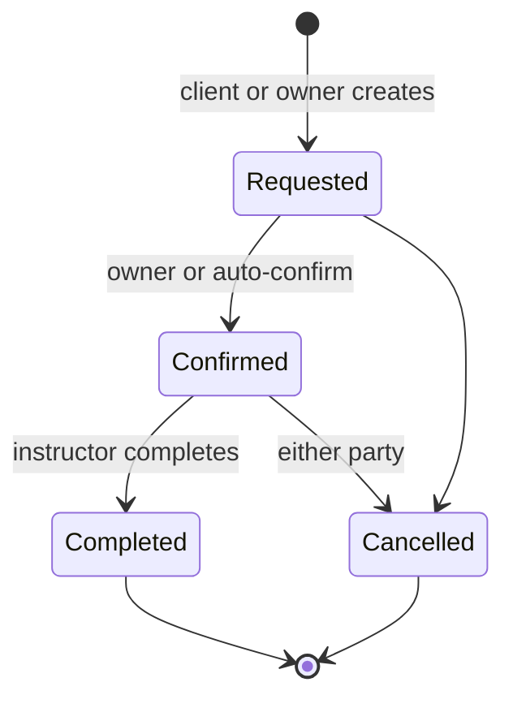
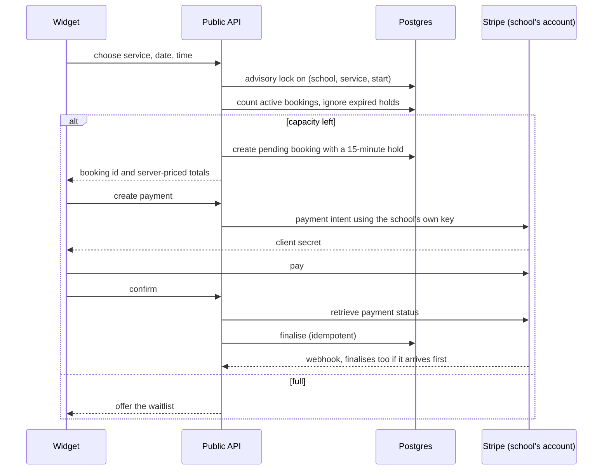
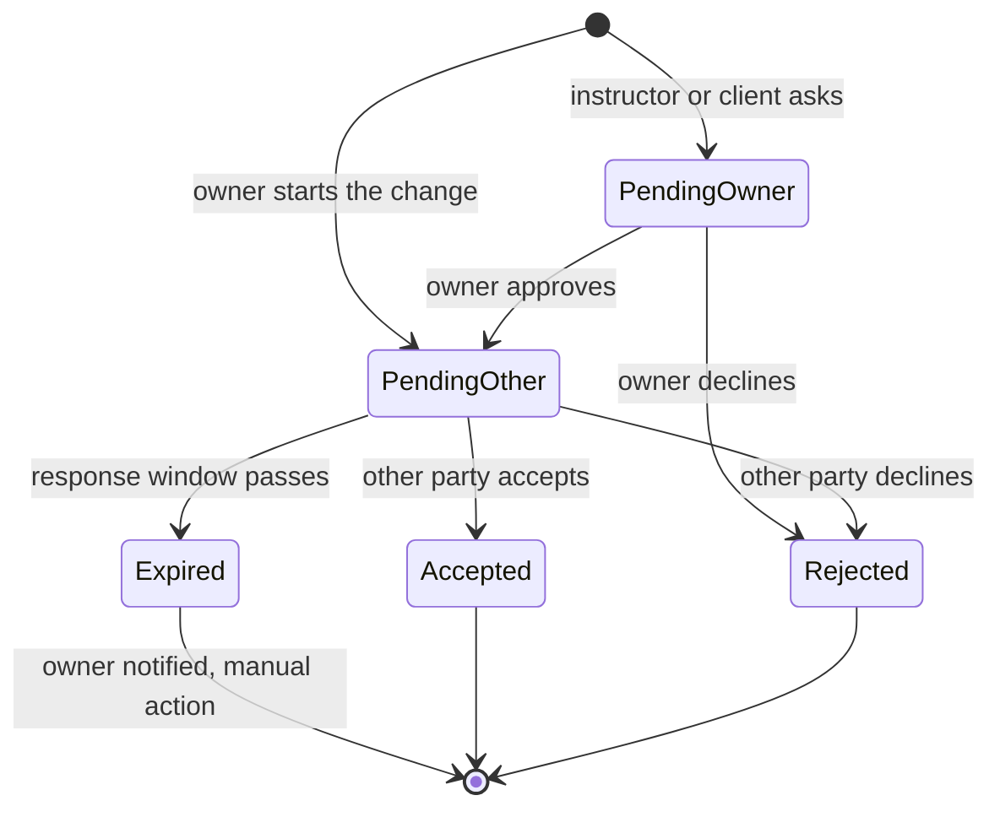
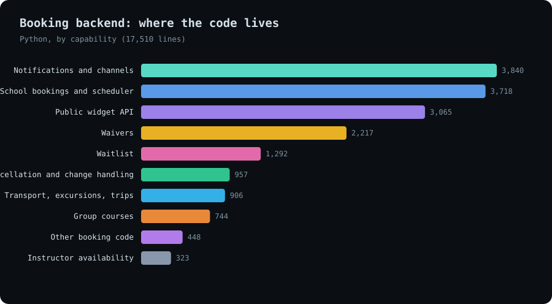
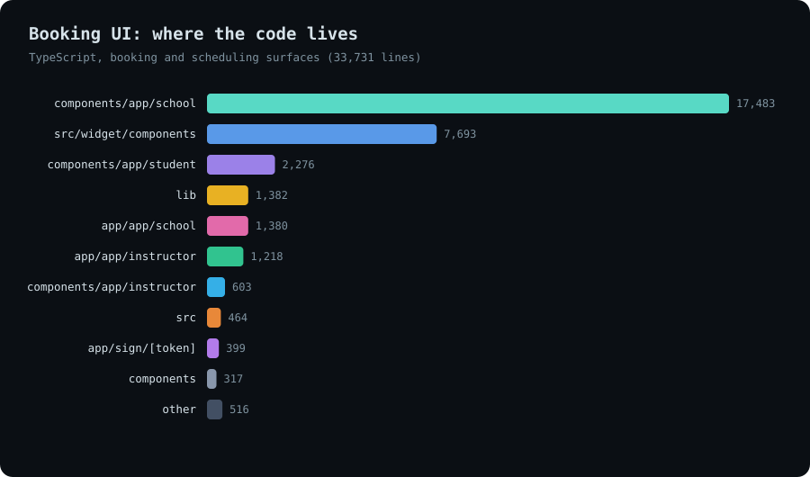
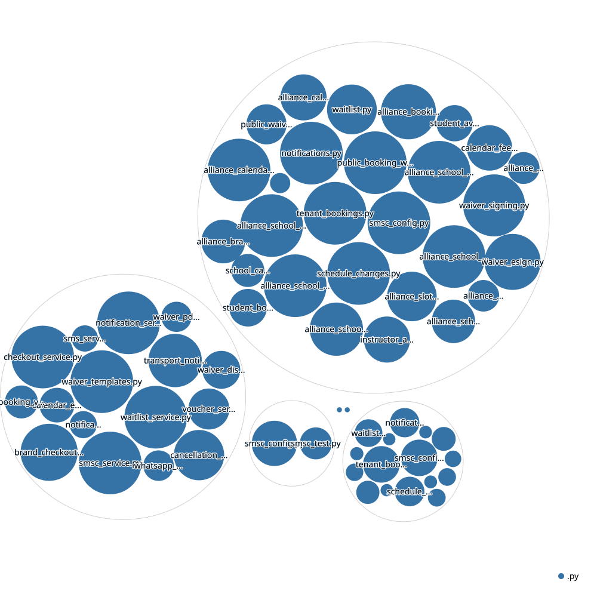
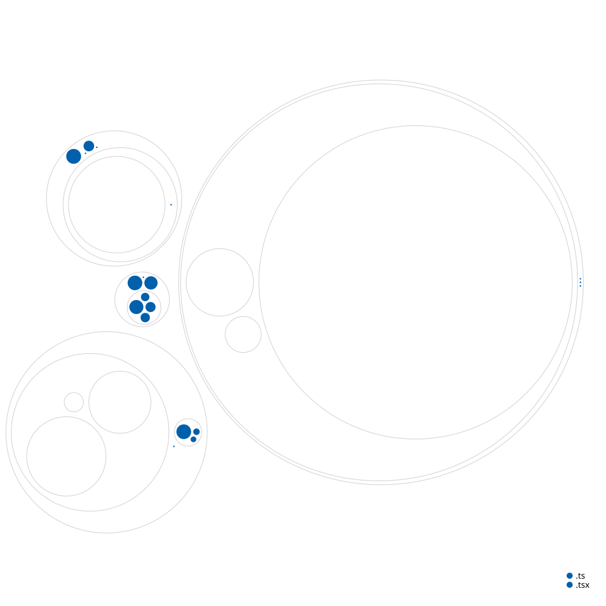

# AllyOS Booking Engine

**Booking, scheduling and change handling for outdoor-sport schools: a slot is sold exactly once, and when plans change the owner, the instructor and the client all agree and all find out.**

*Source is private. This page documents the engine and how it is built. It is one product of the [AllyOS platform](../allyos).*

---

## The product

<!-- TODO: replace with real, anonymised captures; blur personal data -->
| Owner's scheduler | Change-request dialog | Client hub |
|---|---|---|
| _screenshot_ | _screenshot_ | _screenshot_ |

| Booking widget | Instructor's day | Client's lessons |
|---|---|---|
| _screenshot_ | _screenshot_ | _screenshot_ |

Three people use it, each with their own view of the same booking:

| | What they do |
|---|---|
| **Owner** | Plans the day on a drag-and-drop scheduler, builds services and pricing, sets policies, approves changes, chases payments, sees every client's history |
| **Instructor** | Sees their day, blocks mornings or afternoons, proposes changes, records the session, gets paid |
| **Client** | Books and pays from the school's own website through an embeddable widget, signs waivers, sees lessons, asks for changes, gets told what happened |

---

## Architecture

<picture>
  <source media="(prefers-color-scheme: dark)" srcset="../../assets/allyos-booking/architecture-dark.svg">
  
</picture>

[Open the interactive diagram](../../assets/allyos-booking/architecture.html)

Two doors lead to one engine. The **public API** serves the widget with no login, scoped to a school and rate-limited. The **authenticated API** serves the workspaces with roles and permissions. Both go through the same booking engine, so a slot sold from a school's website and a slot placed by the owner on the scheduler obey the same rules.

---

## The life of a booking

- **The state machine is a table, not scattered `if` statements.** Only listed transitions are allowed, anything else is rejected, and only the instructor can complete a session.
- **Every transition is written to an audit record:** who, from which state, to which, and why.
- **No-shows are recorded as their own outcome** on school bookings, and unpaid holds expire (below).

---

## Selling a slot exactly once

Two clients tapping the same last place at the same moment is the classic booking bug. The engine closes it at three levels.

- **Serialised capacity check.** A transaction-level advisory lock keyed on school, service and start time makes concurrent attempts queue, so two requests cannot both pass the capacity check and both insert.
- **Instructor moves are protected too.** Repositioning a booking on the scheduler takes a lock keyed on school and instructor and then runs an overlap query on the resolved time window before commit. Two bookings conflict when one starts before the other ends and ends after it starts.
- **Capacity is configurable,** with a default of four clients per slot and a per-school override.
- **Holds expire on their own.** A pending booking holds the slot for 15 minutes. Expired unpaid holds are ignored when counting and cleaned up when availability is read, so abandoned checkouts never block a slot.
- **Minimum lead times are enforced,** with a clear error code.
- **One finalisation path.** A single checkout service inserts bookings and payments and finalises idempotently, whether the confirmation comes from the client or from the payment webhook, whichever arrives first.
- **The school is paid directly.** The payment intent is created with the school's own Stripe key. Deposits, auto-confirmation and payment method preference (card or bank transfer) are school settings. Vouchers are validated up front and only consumed after the payment succeeds.
- **Server-priced.** Totals come from the server, never from the browser. The checkout endpoint is rate-limited per address.

### Two ways to book

| Mode | What the client does | What the school does |
|---|---|---|
| **Sharp** | Picks exact dates and times | Nothing: the slot is held |
| **Flexible** | Gives a trip window ("in town from the 3rd to the 10th") | Places the lessons later, on the best days for conditions |

The flexible window is validated against the service shape (single day, consecutive days, or a flexible window) and capped, so it is neither too small to fit the service nor too large to plan.

---

## When plans change

A change is a request that has to be agreed by the right people, in the right order, within a time limit.

- **A two-gate request.** A reschedule, a cancellation or a new session is proposed by the owner, an instructor or a client. The owner approves first (skipped when the owner is the one asking), then the other party accepts or declines.
- **Accepting applies it.** A reschedule updates the booking's time, instructor and location; a cancellation cancels it and records the reason.
- **It carries the whole proposal.** Proposed date, start and end, instructor and spot, a reason, and a snapshot of the original booking so a change can be compared and reversed.
- **Time limits are school settings.** The instructor and client response windows (six hours by default), the waitlist offer window (two hours), whether an expired request notifies the owner, whether a declined slot is offered to the waitlist, and how many offers a slot may get.
- **A one-minute expiry job** marks timed-out requests and unanswered waitlist offers as expired and notifies the owner and the requester.
- **The update goes where people read it.** The owner can send a schedule update in the app, by email, SMS (each school can bring its own SMS gateway) and WhatsApp, as "accept or decline" or "just acknowledge", to one person or in bulk, and a status panel shows who has replied. Non-responders can be nudged by SMS, WhatsApp or a call.

### Freed slots are sold again

When a booking is cancelled or rejected, the waitlist engine finds eligible entries, ranks them by priority and how specifically they match (instructor, date window, time window, duration, lesson type, spot), and offers the slot to the best match with accept or decline. Offers expire and respect a per-slot limit.

### Policy as configuration

A school builds its cancellation policy from four dimensions, each at four strictness levels: the cancellation window, refund tiers, rescheduling, and what happens when weather cancels. The product generates the readable policy text from the choices.

### Beyond the lesson

Group courses (one instructor, one service, one time range, a capacity and many clients), excursions with boats, vehicles and equipment, and a transport hub where assigning a driver sends the client the driver, vehicle, meeting point and an escalation path by email, SMS and WhatsApp, and sends the driver the pickup details.

---

## Everyone hears the same thing

- **Every state change emits an event.** There are more than twenty event types. The service resolves who should receive each one from the role graph (owner, instructor, client), persists one record per recipient and dispatches to the requested channels, with in-app as the backbone.
- **Notifications can never break a booking.** Emission runs on its own session and swallows its own failures. Failed external sends (email, push) go to a transactional retry queue instead of vanishing into a log line.
- **Views are merged, not duplicated.** The instructor's "my day" and the client's "my lessons" merge the bookings, the pending change requests and the unread notifications, so each role sees one complete picture.
- **Channels per school.** Defaults are set per school: in-app and email out of the box, with SMS, WhatsApp (through Twilio) and push added where configured.

---

## Waivers and documents

Required waivers are sent automatically when a booking is created: the system finds every active template marked required for booking, creates a single-use signing token and a pending document for each, and emails the link. Dispatch is best-effort, so a waiver problem never fails a booking. Clients sign on a public page with a signature pad, the owner can check a booking's compliance and download the signed PDF, and five default templates (wind sports, diving, surfing, a minor-consent add-on, an equipment rental agreement) are seeded for each school to edit.

---

## The front end

- **The scheduler** is a drag-and-drop planner of about 2,200 lines with a client sidebar, capacity indicators, participant strips and a notify bar. Repositioning goes through the same overlap protection as any other booking.
- **Sub-tabs for the day-to-day:** roster, reservations, excursions, transport, spots and a calendar view.
- **A client hub** with a booking timeline, payment ledger, files, notes, invoices and refunds.
- **The widget** is a separate React bundle with a public contract that CI checks, and release checks for caching and source parity.
- **Tests:** 125 backend test functions across availability, checkout, bookings, capacity, calendar, notifications and waivers, and 41 Playwright end-to-end cases covering the widget (with payment), the scheduler, the client hub, the instructor flows and the booking surfaces.

---

## Stack

| Layer | Technology | Why |
|---|---|---|
| API | Python, FastAPI, Pydantic | Typed contracts, one service layer for both doors |
| Data | Postgres, SQLAlchemy | Advisory locks and transactions for slot safety |
| Payments | Stripe with the school's own keys, webhooks | The school is paid directly |
| Messaging | In-app, email, SMS (per-school gateway), WhatsApp, push | Reach people on the channel they read |
| Jobs | Background loops and a retry queue | Expiry, reminders and retries without a separate worker system |
| Web | Next.js 16, React 19, TypeScript, TanStack Query | Server rendering plus an interactive scheduler |
| Widget | React bundled with Vite into one versioned script | Embeds on any school site |
| Quality | Pytest, Vitest, Playwright | Unit, integration and end-to-end |

---

## Key design decisions

| Decision | Trade-off |
|---|---|
| Lock on the slot, then count | A small wait under contention, but oversubscription becomes impossible |
| Pending bookings hold the slot for 15 minutes | Abandoned checkouts free themselves; a slow payer can lose the slot |
| The school's own payment account | Money goes straight to the school, at the cost of per-school payment setup |
| Change requests are a first-class record with two gates | More states to model, but nothing is decided by phone tag and everything is auditable |
| Windows and defaults are settings, not constants | Each school tunes its own rhythm |
| Notifications are events with resolved audiences | One mechanism for every channel and every role |

---

## Honest engineering notes

- Booking data sits in layered tables from successive generations of the product (user-scoped bookings, school bookings, tenant bookings), with some availability and checkout logic in raw SQL. Consolidating them behind one model is a known item.
- The waiver and notification services are best-effort by design, so their failures show up in logs and the retry queue, not to the client.

---

## Build status

| Area | Progress | |
|---|---|---|
| Booking lifecycle, audit and capacity | `▰▰▰▰▰▰▰▰▰▱` 90% | Built and tested |
| Slot safety (locks, holds, idempotent finalisation) | `▰▰▰▰▰▰▰▰▰▱` 90% | Built and tested, end-to-end widget cases |
| Public widget and checkout | `▰▰▰▰▰▰▰▰▱▱` 85% | Card and bank transfer, vouchers, waivers |
| Scheduler and school operations | `▰▰▰▰▰▰▰▰▱▱` 80% | Drag and drop, roster, excursions, transport |
| Change requests, waitlist, policy builder | `▰▰▰▰▰▰▰▰▱▱` 80% | Built, including applying an accepted change to the booking |
| Notifications and channels | `▰▰▰▰▰▰▰▱▱▱` 70% | In-app backbone, email, SMS and WhatsApp built |
| Multi-day travel packages | `▰▰▱▱▱▱▱▱▱▱` 20% | Architecture brief written |

*Percentages are estimates against the intended scope.*

---

## Size and structure

| Part | Files | Lines of code |
|---|---|---|
| Booking backend (Python) | 64 | ~17.5k |
| Booking user interface (TypeScript) | 147 | ~33.7k |
| Tests | 13 backend files (125 functions) + 11 end-to-end specs (41 cases) | |

| Backend by capability | Booking UI by area |
|---|---|
|  |  |

**Structure maps** (circle size is file size, colour is file type; folder and file names only):

| Backend | Booking UI |
|---|---|
|  |  |

---

## Status

Active development. Open to licensing, partnership and consulting.

**Contact:** [antigravityalliance.com](https://antigravityalliance.com) · [dev@allyos.app](mailto:dev@allyos.app) · +27 76 931 7108
