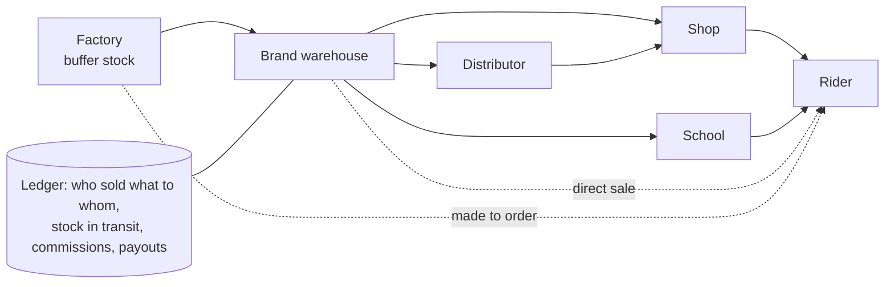
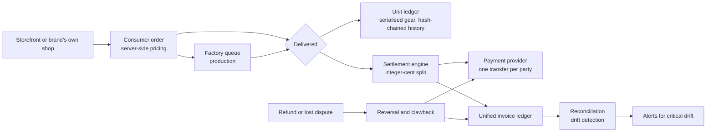
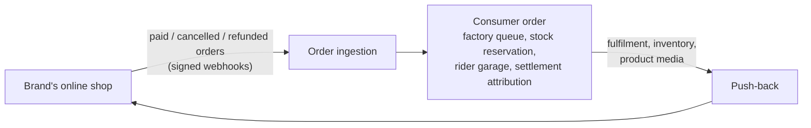
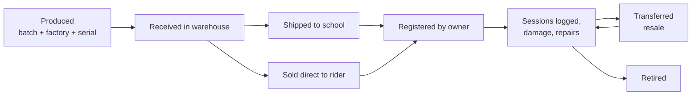

# AllyOS ERP

**The ERP built specifically for the water-sports industry: brands, factories, distributors, shops, schools and riders on one system, from storefront order to factory, delivery, multi-party payout, invoice and reconciliation.**

*Source is private. This page documents the system and how it is engineered.*

---

## Screenshots

<!-- TODO: replace with real, anonymised captures -->
| Brand: orders and settlement | School: finance tab | Factory portal |
|---|---|---|
| _screenshot_ | _screenshot_ | _screenshot_ |
| Unified invoice (PDF) | Reconciliation report | Fleet program |
| _screenshot_ | _screenshot_ | _screenshot_ |

---

## Why an industry-specific ERP

Water-sports gear does not fit a generic business suite. Gear is serialised and changes hands several times in its life. Schools are at once customers, retailers, fleet owners and warranty service points. A single sale pays out to five or six parties, and a used-gear resale pays out to different ones. Seasons, pre-orders, factory buffer stock and instructor royalties are everyday facts, not special cases.

AllyOS ERP models those facts natively: the product passport, the multi-party settlement, the fleet and buyback programme, the school back office, the factory portal and the warranty network all share one data model, one set of money rules and one audit trail.

---

## Built for brands: see and control the whole chain

A brand's gear passes through many hands: factory, warehouse, distributor, another warehouse, shop, school, rider. Most brands only see the first hop or two, and no one can say who sold a given kite to whom. AllyOS gives the brand one system for the whole chain, and the freedom to sell direct to riders, even straight from the factory, when it chooses.

- **Where is it?** Two-tier stock (factory buffer, then brand warehouse) with a modelled in-transit window, so units are never counted twice or lost between sites. Warehouse transfers, B2B shipments and carrier tracking follow the goods.
- **Who sold it to whom?** Wholesale orders to distributors, shops and schools, consumer orders with the school or instructor attribution recorded, and a settlement ledger that shows exactly who was paid what for each sale.
- **What happened to this unit?** The digital product passport records production, warehouse, shipment, sale, owner, repair, resale and retirement, built with the EU's coming product-passport rules in mind.
- **Direct when ready.** Native checkout, a Shopify bridge and factory-to-consumer orders let a brand sell direct without leaving the old channel behind.

| The brand's problem | What AllyOS does |
|---|---|
| "Our systems only know wholesale." | Native checkout and a Shopify bridge put consumer orders into the same system as B2B orders, with one catalogue, one stock position and one set of books. |
| "Going direct will upset our dealers and schools." | A school or instructor who brought the rider is recorded on the order and earns a commission automatically, so the local channel gains from direct sales and no longer loses to them. |
| "We build to order, but our shop doesn't." | Orders go straight into the factory's queue. Gear in stock ships; the rest is a made-to-order pre-order with a deposit, and the factory is paid its share at settlement. |
| "We lose track of what we sold." | Every unit gets a passport from production onward, so the brand knows who owns it, its repairs and its resale. |
| "We are locked into the old system." | Catalogue import that merges into live data without overwriting it, a read-only readiness audit before go-live, and SKU normalisation plus a legacy-identifier map so old product codes keep matching. The existing shop can stay in place during the switch. |
| "Resale and warranty are someone else's problem." | Certified resale with royalty back to the original seller, school service points for warranty, and fleet buyback programmes. |

The same system keeps the wholesale side running (price lists, volume tiers, B2B orders, distributor and shop accounts), so a brand moves channel by channel instead of all at once.

---

## Who it is for

| You are | What the ERP gives you |
|---|---|
| **A brand** | Catalogue with variants, pairings, seasons and price lists; wholesale and consumer orders; production orders, batches and quality alerts with demand forecasts; inventory across factory buffer and warehouse; commission agreements; a CRM across riders and business accounts; settlement, invoicing and refunds; digital product passport for every serialised unit. |
| **A distributor or shop** | A buyer-facing catalogue with your own net prices (price lists, volume tiers), B2B ordering, invoices, shipments and stock visibility, with the brand's order history and payments kept in one CRM. |
| **A school** | Fleet programme with discounted gear, rotation buybacks and credits; a commission on what students buy; local service point for warranty claims; plus the school back office: accounts, receivables and payables, payroll, assets and reports. |
| **A factory** | A scoped portal with API keys, an order queue, buffer stock and costed quotes (bill-of-materials pricing), so production orders flow in without email. |
| **An instructor** | Contracts, instructor invoices and payroll, and payout of lifetime royalties on gear their students bought. |
| **A rider** | A garage of serialised gear with its full history, certified resale of used gear with seller payout, and warranty and spare-part claims. |
| **The platform operator** | Reconciliation, dispute handling, refunds with clawback, held-funds release and an alert inbox, all with a written runbook. |

---

## What it does

One platform runs the money and goods for every party in a gear ecosystem.

- **Catalogue and orders.** Brand catalogue with variants, pairings and a consumer product model. Orders arrive from a native storefront, from a brand's own online shop, or through wholesale; pricing is always computed on the server.
- **Production.** Production orders, batches and quality alerts for the brand; a portal, API keys, order queue, buffer stock and cost quotes for the factory.
- **Settlement.** When an order is delivered, the platform splits the revenue between every party and pays each through its own transfer, using configurable per-brand commission terms.
- **Used-gear resale and fleets.** Riders resell certified gear; schools run discounted fleets with rotation buybacks and credits, on the same settlement rails.
- **After-sales.** Warranty claims, assessment at a local school service point, spare parts and stock, and a digital product passport for each unit.
- **Invoicing.** One invoice engine for any payer and payee pair, replacing five divergent invoice systems.
- **School back office.** Accounts and transactions, receivables and payables, payroll and instructor invoices, assets, inventory (school, shop, brand and warehouse), tax profiles, exchange rates and financial reports.
- **Safety net.** Refunds with clawback, dispute handling, held seller funds, and a reconciliation report that looks for money-math drift.

---

## The money path

[Explore the interactive diagram](../../assets/allyos-erp/architecture.html)

---

## Two ways to sell

**Native checkout: AllyOS as the shop backend.** A brand's storefront, on any domain and any front-end stack, talks to a public checkout API. The server prices the cart (never the client), creates a payment through Stripe routed straight to the brand's own connected account, and confirms the order by re-reading the payment from Stripe, so a tampered or replayed request cannot confirm an order. Order, factory queue, settlement, invoicing and the product passport then run on the same rails with no second system in between. Brands already on Stripe can run the whole sale this way.

**Shopify bridge: AllyOS behind an existing shop.** For brands that keep their Shopify store, AllyOS sits behind it as the operational system of record (below). Either way, everything after the order is identical.

---

## Integrations

**Online shops: Shopify, two-way.** A brand keeps selling on its own Shopify store, where Shopify owns checkout, payment, tax and shipping. AllyOS becomes the operational system of record behind it.

- **In:** every webhook is authenticated by an HMAC signature compared in constant time, so a leaked connection id alone cannot inject orders. Handlers are idempotent per Shopify order, unknown topics are acknowledged, and handler errors never trigger a retry storm. Items are matched on SKU; unmatched SKUs are recorded on the order and its link record instead of being silently dropped, and an order with no matching items is flagged on the connection for the brand to see.
- **Through the same funnel:** a Shopify order passes through the same order state machine as a card-paid order and fires the same side effects (payout and terms snapshot, factory enqueue, stock reservation, rider profile created or reused), so settlement treats both identically.
- **Out:** fulfilment and inventory are pushed back through Shopify's GraphQL Admin API. These are best-effort side effects with bounded retries: a Shopify outage can never block a shipment or a stock change, and a full resync (button or scheduled) heals any drift. Product images and alt text can be pushed on demand as a batch job.
- **Secrets:** Admin tokens and webhook secrets are encrypted at rest and never returned by the API.
- **Storefronts:** the shared site engine ships a typed Storefront API client and a multi-brand cart with referral attribution, so a school's or association's site can sell a brand's gear and carry the referral through to the order.

**Payments: Stripe.** Card payments, Connect accounts for every payee, and separate platform subscriptions for the SaaS plans, each with its own webhook receiver.

**Shipping: carrier tracking.** An aggregator-agnostic webhook receiver with per-provider signing secrets. A missing secret fails closed in production. Reaching "delivered" is what triggers settlement, and a manual advance exists for carrier outages.

**Any shop platform.** Shopify is the reference integration, and others connect the same way: orders in by webhook, fulfilment and stock pushed back through the platform's API. Everything after an order enters AllyOS (factory queue, stock, settlement, invoicing) is the same whatever shop it came from. Live today: Shopify.

---

## Digital product passport

Every physical unit of gear can be followed from factory to retirement.

- **One record per serialised unit**, with its brand, product variant, serial number (unique per brand), factory, production batch and production date. Each unit can be traced back to the consumer-order line it was built for.
- **An append-only event ledger** is the single source of truth: produced, received, shipped, sold, registered, damage reported, repair logged, hours logged, transferred, retired. Events are never updated or deleted; the unit's status and running totals (hours, open damage) are a convenience derived from them.
- **Written by the flows, not by hand.** Production, order, checkout and factory processes append events; brands get a read-only registry and per-unit timeline.
- **It earns its keep downstream.** Provenance tells settlement which school and instructor sold a unit originally, so lifetime royalties find the right payee when it is resold. Warranty claims can attach to a specific unit and its history (gear without a serial is claimed by description), and a local school can assess it as a service point.
- **Two layers, one idea.** The brand-side registry covers production through retirement. The rider-side "gear garage" mints a serialised unit with a hash-chained history when an order is delivered, and keeps the original-seller provenance used for royalties.
- **Ready for regulation.** The EU's ecodesign regulation (ESPR, Regulation (EU) 2024/1781) introduces digital product passports, rolled out product group by product group through delegated acts. Textiles are among the first groups, and which sports-gear categories follow, and when, is still open. AllyOS already records what passports are built from (origin, production batch, ownership, repairs, resale, end of life), so a brand that adopts it now has the history in place instead of retrofitting later. This is a design direction, not a compliance claim: the exact data fields and formats will follow the final rules.

---

## Stack

| Layer | Technology | Why |
|---|---|---|
| API | Python, FastAPI, Pydantic | Typed request and response contracts, async I/O |
| Data | Postgres, SQLAlchemy models, Alembic migrations | Relational integrity and partial unique indexes for money invariants |
| Payments | Stripe Connect (separate transfer per party), webhooks | Each payee is paid and reversed independently |
| Documents | Server-side invoice rendering to PDF | One layout for every payer and payee |
| Shop integration | Shopify webhooks in, GraphQL Admin API out | Orders arrive without manual entry; stock and fulfilment stay in sync |
| Shipping | Carrier-tracking webhooks (HMAC-signed) | Delivery events drive settlement |
| Ops | Written runbook, read-only audit scripts, alert inbox | Operators can diagnose and fix without a developer |

---

## How it is engineered

**All money is integer cents.** Splits use basis points and floor division in pure functions, with the remainder absorbed by one designated line so that the parts always sum to the total exactly. There are no floats in the new money path. The older finance tables that used floating-point amounts are being consolidated into the cent-based invoice engine.

**Settlement is idempotent.** One settlement run per order, enforced by a partial unique index, with the order row locked while the run is created. Every transfer also carries its own idempotency key at the payment provider, so a replayed delivery event or a manual re-run can never pay twice.

**It fails closed.** A party with no payout account gets a line marked "no account" and the run stays partial; money is never sent to nowhere. Payout targets are snapshotted when the deposit is paid, not looked up live at settlement. Seller lines that settled before the seller finished onboarding stay held and release automatically when the account goes active.

**Every payee is reversible on its own.** Separate transfers per party mean a refund or lost dispute claws back exactly what each party received, capped by a cumulative refund ratio so a clawback can never over-draw. An open dispute freezes settlement. Refunds only go through one sanctioned path, and the runbook warns operators why.

**Invoicing is fail-open on purpose.** Settlement never fails because invoicing failed: the error is recorded on the run and a retry sweep re-invoices later, safely and idempotently.

**A real reconciliation layer.** A read-only report checks the whole ledger for eight kinds of anomaly. Three are critical (a split that does not add up, a double payment, an over-refund) and page through deduplicated alerts; the rest are warnings with defined fixes. A background monitor runs the scan daily over the current and the previous month (drift often lands just after a month rolls over) and raises operator alerts, so stuck money pages someone instead of waiting to be found.

**Defensive input handling.** Prices never come from the client. Gear-kit conversion is all-or-nothing and locks the kit row against concurrent double conversion. Resale is priced from the stored listing. Currency is checked and fails closed. Factory API keys are shown once, stored only as hashes and compared in constant time.

**Provenance on every unit.** Gear is serialised from production onward with an append-only event history; on delivery, the rider's copy is minted with a hash-chained history and the recorded original seller, so lifetime royalties can later find the right payee.

**Operable by humans.** A written runbook gives symptom, diagnosis and fix for each failure mode, with the invariants operators can rely on. A read-only readiness audit (it refuses to run unless the database confirms read-only mode) diffs the catalogue against the website master data before go-live.

---

## Key design decisions

| Decision | Trade-off |
|---|---|
| Separate transfer per party instead of one lump payout | More payment-provider calls, but each party can be reversed on its own |
| One polymorphic invoice engine (a party registry plus payer and payee) instead of five relationship-specific tables | A migration and backfill to run, but one numbering scheme, one PDF and one payment model |
| Invoicing fail-open, settlement never blocked | Needs a retry sweep and a reconciliation check, but money never stalls on a document error |
| Pure-function split math, isolated from I/O | Easy to prove exhaustively in tests, harder to bolt on special cases casually |
| Commission terms resolved in one place, with defaults identical to the old hard-coded values | Legacy orders settle unchanged while each brand can have its own agreement |
| Reconciliation is strictly read-only, and alerting is a separate step | One extra layer, but looking at the books can never change them |

---

## Build status

A platform this broad is never finished all at once, and this page says where each area stands. Percentages are an honest estimate of completeness against the intended scope.

| Area | Progress | |
|---|---|---|
| Catalogue, variants, pairings, price lists | `▰▰▰▰▰▰▰▰▰▱` 90% | Built and tested |
| Consumer orders and state machine | `▰▰▰▰▰▰▰▰▰▱` 90% | One shared funnel for every order source |
| Settlement, reversals, disputes | `▰▰▰▰▰▰▰▰▰▱` 90% | Idempotent, per-party, runbook written |
| Factory portal and queue | `▰▰▰▰▰▰▰▰▱▱` 85% | Keys, queue, buffer stock, cost quotes |
| Shopify bridge | `▰▰▰▰▰▰▰▰▱▱` 85% | Orders in; fulfilment, stock per location, media out |
| Gear kits, resale, fleet programme | `▰▰▰▰▰▰▰▰▱▱` 85% | Large test suites |
| End-to-end unit tracking (factory to distributor to shop to rider) | `▰▰▰▰▰▱▱▱▱▱` 50% | Stock and orders tracked across every hop; serial-level custody built for warehouse, school and rider, being extended to distributors and shops |
| Digital product passport | `▰▰▰▰▰▰▰▰▱▱` 80% | Registry and timeline built; more event sources to wire |
| Unified invoicing | `▰▰▰▰▰▰▰▰▱▱` 80% | Engine and PDF built; older invoice systems still being folded in |
| Reconciliation and alerts | `▰▰▰▰▰▰▰▰▱▱` 80% | Eight checks built, run daily by a background monitor that raises operator alerts |
| School back office (accounts, AR/AP, payroll, reports) | `▰▰▰▰▰▰▰▰▱▱` 75% | Broad feature set; moving to cent-based amounts |
| Native checkout | `▰▰▰▰▰▰▱▱▱▱` 65% | Server pricing, Stripe payment and confirmation built; multi-currency and stock reservation in progress |
| Stock reservation at checkout | `▰▰▰▰▰▰▱▱▱▱` 55% | Built on the Shopify path; being extended to native checkout |
| Multi-currency | `▰▰▰▰▰▱▱▱▱▱` 50% | Invoices and exchange rates support it; order pricing being opened up beyond the launch currency |
| Other shop platforms | `▰▱▱▱▱▱▱▱▱▱` 10% | Pattern proven with Shopify; further adapters to come |

---

## Security and compliance

**Controls in place**
- **Tenant isolation** enforced in the database with row-level security.
- **Secrets:** no credentials in code, tokens encrypted at rest, API keys stored only as hashes, signed webhooks, a rotation checklist.
- **Audit trail:** audit-log records and append-only event ledgers.
- **Change control:** CI on every change, linted commits, automated code review, versioned migrations; the web app also runs secret scanning and dependency audits.
- **Public surface:** anonymous endpoints are rate-limited and scoped.

**Compliance roadmap.** SOC 2 certification has not been started. The path:

| Step | Progress | |
|---|---|---|
| Technical controls (isolation, secrets, audit trail, change control) | `▰▰▰▰▰▰▰▱▱▱` 70% | In place, see list above |
| Written security policies | `▰▱▱▱▱▱▱▱▱▱` 10% | Planned |
| Compliance automation and evidence collection | `▱▱▱▱▱▱▱▱▱▱` 0% | Planned: Vanta |
| Independent SOC 2 audit | `▱▱▱▱▱▱▱▱▱▱` 0% | Planned, after an observation period |

---

## Size and structure

| Part | Files | Lines of code |
|---|---|---|
| ERP domain code (services, models, endpoints, schema setup) | ~156 | ~39k |
| ERP tests | 45 files, 573 test functions | ~14k |
| Data models in the domain | 35 | |

Largest test suites: factory portal, settlement reversal, fleet program, unified invoices, reconciliation, seller payout, payment disputes.

*Counts are approximate: files whose names belong to the ERP domain, inside the shared AllyOS backend.*

<!-- TODO: structure.svg (repo-visualizer, ERP subset) -->

---

## Status

Active. Open to licensing, partnership or acquisition conversations, and consulting.

**Contact:** [antigravityalliance.com](https://antigravityalliance.com) · [dev@allyos.app](mailto:dev@allyos.app) · +27 76 931 7108
