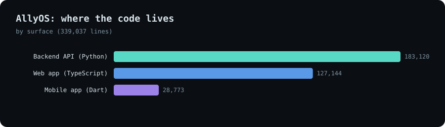
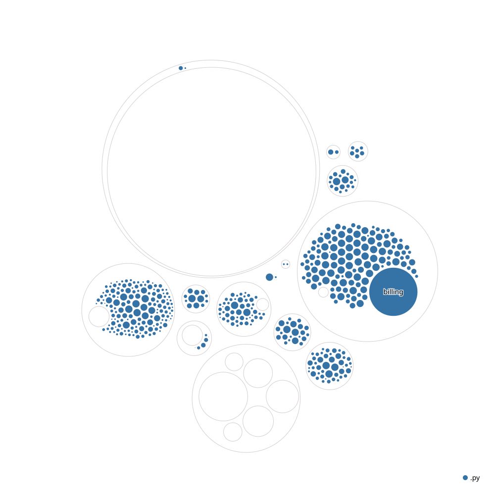

# AllyOS

**The operating system for outdoor-sport schools and operators: scheduling, bookings, clients, instructors, gear, money and conditions on one multi-tenant platform, with chat-operated assistants.**

*Source is private. This page documents the product and, mainly, how it is engineered.*

---

## The product in one picture

An outdoor-sport school is run by three people who need each other and rarely sit at the same desk: the **owner**, the **instructor** and the **client**. A forecast changes, an instructor is sick, a client needs another day. AllyOS gives each of the three a workspace on one shared set of facts, and treats *change* as the main case.

<!-- TODO: replace with real, anonymised captures; blur personal data -->
| Owner's scheduler | Change-request dialog | Client hub |
|---|---|---|
| _screenshot_ | _screenshot_ | _screenshot_ |

| Instructor's day | Client's lessons | Booking widget on a school site |
|---|---|---|
| _screenshot_ | _screenshot_ | _screenshot_ |

| | Workspace |
|---|---|
| **Owner** | Overview; a drag-and-drop scheduler with roster, reservations, excursions, a transport hub, spots and calendar view; a client hub (CRM) with booking timeline, payment ledger, files, notes, invoices and refunds; a service builder with pricing rules and blackout dates; team; inventory; finance; widget setup |
| **Instructor** | Dashboard, calendar, sessions, journal, students and progress, availability, payouts |
| **Client** | Lessons, calendar, availability, documents, progression ladder, payments, messages, a "request a change" button |

The booking and change-handling engine is on the [Booking page](../allyos-booking). Chat-operated assistants are in the [assistants and MCP note](assistants-and-mcp.md).

---

## Architecture at a glance

<picture>
  <source media="(prefers-color-scheme: dark)" srcset="../../assets/allyos-platform/architecture-dark.svg">
  
</picture>

[Open the interactive diagram](../../assets/allyos-platform/architecture.html)

**Deployment topology.** Web apps on Vercel with error monitoring, the API as a container service with Redis for coordination, managed Postgres, and an embeddable widget served as a versioned static script. Operators are tenants of one deployment, not separate installs. A health endpoint reports the running commit, so any environment can say exactly what it is running.

---

## Backend architecture

### The request path

```mermaid
flowchart LR
  C[Client] --> CORS[CORS allowlist<br/>per environment]
  CORS --> RL[Rate limits and<br/>scrape guard on public paths]
  RL --> AUD[Audit middleware<br/>automatic action log]
  AUD --> TC[Tenant context<br/>per request, async-safe]
  TC --> AUTH[Auth dependency<br/>JWT, key, or signed token]
  AUTH --> ACC[Access check<br/>owner, member, or admin]
  ACC --> RBAC[Permission check<br/>resource and action]
  RBAC --> H[Handler]
  H --> SVC[Service layer]
  SVC --> DB[(Postgres<br/>row-level security)]
```

- **Tenant context is request-scoped and async-safe.** It uses context variables, so every concurrent request carries its own tenant, user and role without sharing state.
- **Object-level access is its own dependency.** A school-access check confirms the caller owns the school, belongs to its team, or is a platform admin, which prevents insecure direct object references. The same check exists as a pure function for the service layer and for AI tools, so the rule is written once.
- **Each audience has its own rail.** Brands resolve through brand membership with role tiers. Factories and brokers accept either an API key (for external ERP and TMS integrations) or a member session, so integrations and staff share endpoints under one policy.
- **Entitlements come from billing state.** The rider tier is derived from subscription records. A payment in retry still counts as active: cutting access on the first failed charge would be punitive.
- **Tiers live in one registry.** Adding a paid role is one entry, with the frontend mirroring it.
- **Permissions are declarative.** Endpoints declare the resource and action they need, and a dependency enforces it.
- **Public endpoints are protected from scraping:** rate limits, pagination caps, progressive delay and suspicious-pattern detection on directory, discovery and weather routes.

### Reliability patterns

| Problem | Pattern used |
|---|---|
| A side effect (push, email, settlement-to-invoice) fails silently | **Transactional outbox:** the retry job commits atomically with the business change; a dispatcher claims due jobs with `SKIP LOCKED`, runs each in a savepoint, retries with exponential backoff, and keeps exhausted jobs visible in an admin view instead of deleting them |
| A payment webhook is delivered twice or concurrently | **Event claim ledger:** the event id is inserted atomically under a primary key, so exactly one delivery wins; the claim is released if the handler crashes so a replay is not swallowed |
| Many requests refresh the same weather data at once | **Single-flight lock** in Redis; if Redis is down it fails open so requests stay serviceable |
| A notification failure must not undo a booking | **Fire-and-forget emitter** on its own session |
| Webhooks must not cause retry storms | **Never-5xx acknowledgement:** handler errors are logged, with idempotency inside the handlers |
| Money drift | A daily background monitor reconciles the ledger and alerts an operator |
| Schema must reach production safely | **Idempotent, ordered boot-time schema functions** that only add (`IF NOT EXISTS`), in foreign-key order, alongside the migration history |

### Background workloads

Ten loops start with the API; more are triggered by cron or an endpoint.

| Workload | Cadence |
|---|---|
| Weather polling and cache warming | Scheduled, plus a cron trigger |
| Wind-alert dispatcher | Every tick, with de-duplication windows |
| Schedule-change and waitlist expiry checker | Every minute |
| Abandoned-cart reminders | Every five minutes |
| Admin watchdog | Every ten minutes |
| Forecast regeneration (ARIA) | Every six hours |
| Daily spot scoring | Checked every six hours, works once a day, self-heals after a restart |
| Outbox dispatcher | Continuous, with backoff |
| Money-path monitor | Daily, current and previous month |
| Badge computation | Scheduled |

### Data and integrations

- **Data:** 155 models and 52 schema modules, one engine for the whole application (nothing else may create connections), separate main and school database connections, and 150+ migrations.
- **Payments:** Stripe for the platform's own subscriptions and, separately, for every connected payee, each with its own webhook receiver.
- **Messaging:** email, SMS (each school can configure its own gateway), WhatsApp and push.
- **Conditions:** forecast models, calibrated per spot by [ARIA](../aria).
- **Maps and travel:** Mapbox, and flight search for the travel assistant.
- **Voice and chat:** conversational voice agents, WhatsApp and Telegram inbound, MCP.

---

## Frontend architecture

- **Next.js 16 App Router with React 19,** server rendering for public and SEO pages, TypeScript, Tailwind 4.
- **An edge proxy gates every authenticated route.** It checks the access cookie, validates it against the API, caches the check briefly, and silently exchanges the refresh token for a new access token when one expires, so users are not bounced to login for a routine expiry. If the API itself is unreachable it does not block the page, because an outage on the probe is not the user's fault.
- **A typed API layer.** About 130 client modules, one per backend area, and server actions (35 files) for mutations. Types for the weather contract are generated from a JSON schema, and CI fails if the generated file is stale.
- **Role shells.** One application serves owner, instructor, student, rider, brand and admin workspaces behind a role-aware shell.
- **White-label by host.** A registry resolves the request host to a brand configuration (name, logo, theme), so the same deployment appears in each operator's look.
- **The widget is its own build.** The embeddable booking script is a separate React bundle, versioned, with checks for cache policy, release readiness, source parity and the public booking contract before it ships.
- **A bundle-size budget with a written history.** CI fails if shipped client JavaScript exceeds the ceiling, and every increase is recorded with the feature that caused it (a map library, a voice widget, a signing surface). The ceiling is raised deliberately, never to silence a failure.
- **Observability.** Sentry on client, server and edge.
- **Tests.** Unit tests with Vitest, and Playwright end-to-end specs for the booking surfaces, the widget with payment, the scheduler, the client hub, the instructor flows, invoices, the gear configurator and white-labelling.

---

## Chat-operated

Role-based assistants call typed, audited, tenant-scoped tools from the app, WhatsApp, Telegram, voice, any MCP client and a scheduler, with confirmation gates before anything changes. See the [assistants and MCP note](assistants-and-mcp.md).

<picture>
  <source media="(prefers-color-scheme: dark)" srcset="../../assets/allyos-assistants/architecture-dark.svg">
  
</picture>

---

## One platform, any outdoor sport

The core does not care which sport is taught. What differs is a small set of sport-specific pieces:

| Sport-specific piece | Wind and wave sports (built) | Another sport would need |
|---|---|---|
| **Conditions driver** | Wind window, calibrated per spot | Swell and tide, visibility and tide, snow and avalanche data |
| **Atomic unit** | Spot and session | Break, dive site, crag or run |
| **Certification map** | Instructor and school accreditation | The governing bodies of that sport |
| **Lesson flow** | Theory, land, water, multi-day progression | That sport's progression and logging |
| **Equipment taxonomy** | Kites, bars, boards, foils, harnesses | Tanks and regulators, boards and leashes, ropes and harnesses |

**Proven in wind and wave sports; other sports are designed, not yet shipped.**

---

## Stack

| Layer | Technology |
|---|---|
| API | Python, FastAPI, Pydantic, SQLAlchemy, Alembic |
| Data | Postgres with row-level tenant isolation; Redis for coordination |
| Web | Next.js 16, React 19, TypeScript 6, Tailwind 4, TanStack Query, React Hook Form, Zod, Mapbox GL |
| Embeds | React widget bundled into one versioned script |
| Mobile | Flutter |
| Messaging | In-app, email, SMS, WhatsApp, push |
| AI | Anthropic provider behind an interface; role-based assistants; MCP server; voice agents |
| Payments | Stripe, including connected accounts |
| Quality | Pytest, Vitest, Playwright, ESLint, commitlint, secret scanning, bundle budgets |
| Delivery | Docker, GitHub Actions, Vercel, Sentry |

---

## Honest engineering notes

- Production schema changes reach the database through ordered, idempotent boot-time functions, because the migration history carries legacy parallel heads and is stamped, not run, there. Consolidating to a single path is a known item.
- The assistant layer has little automated test coverage so far, and an answer-quality evaluation harness is not built.
- Some older finance tables still use float amounts and are being folded into the cent-based invoice engine.

---

## Security and compliance

**Controls in place**
- **Tenant isolation** enforced in the database with row-level security, with a written design for tenant-scoped uploads.
- **Access checks written once:** object-level school, brand and factory access dependencies, reused by the service layer and the assistant tools.
- **Secrets:** no credentials in code, tokens encrypted at rest, API keys stored only as hashes and compared in constant time, signed webhooks and signed expiring tokens, and a rotation checklist.
- **Audit trail:** an audit middleware, admin audit records, an assistant audit log and append-only event ledgers.
- **Change control:** CI on every change, linted commits, automated code review and versioned migrations; the web app also runs secret scanning, dependency audits and bundle budgets.
- **Public surface:** anonymous endpoints are rate-limited and scoped, with scrape protection on directory and weather routes.

**Compliance roadmap.** SOC 2 certification has not been started.

| Step | Progress | |
|---|---|---|
| Technical controls | `▰▰▰▰▰▰▰▱▱▱` 70% | In place, see list above |
| Written security policies | `▰▱▱▱▱▱▱▱▱▱` 10% | Planned |
| Compliance automation and evidence collection | `▱▱▱▱▱▱▱▱▱▱` 0% | Planned: Vanta |
| Independent SOC 2 audit | `▱▱▱▱▱▱▱▱▱▱` 0% | Planned, after an observation period |

---

## Build status

| Area | Progress | |
|---|---|---|
| Booking engine, scheduler and change handling | `▰▰▰▰▰▰▰▰▰▱` 85% | Built and tested end to end |
| Platform core (tenancy, auth, audit, outbox, jobs) | `▰▰▰▰▰▰▰▰▱▱` 85% | Patterns in place and tested |
| Frontend (role workspaces, widget, white-label) | `▰▰▰▰▰▰▰▰▱▱` 80% | Broad; end-to-end specs for the main flows |
| Assistants and MCP | `▰▰▰▰▰▰▰▱▱▱` 70% | Runtime, roles and channels built; tests and evaluation to add |
| Mobile app | `▰▰▰▰▰▰▱▱▱▱` 60% | Core flows |
| Second sport family | `▰▱▱▱▱▱▱▱▱▱` 10% | Designed |

*Percentages are estimates against the intended scope.*

---

## Size and structure

| Surface | Lines of code |
|---|---|
| Backend API (Python) | ~183k |
| Web app (TypeScript) | ~127k |
| Mobile app (Dart) | ~29k |

~240 API endpoint modules · 155 data models · 129 service modules · 150+ migrations · 216 test files · 550+ backend commits in about eight months.

| Backend by module | Web app by area |
|---|---|
|  |  |

**Structure maps** (circle size is file size, colour is file type; folder and file names only):

| Backend | Web app |
|---|---|
|  |  |

---

## Status

Active development. Open to licensing, partnership, acquisition conversations, and consulting.

**Contact:** [antigravityalliance.com](https://antigravityalliance.com) · [dev@allyos.app](mailto:dev@allyos.app) · +27 76 931 7108
