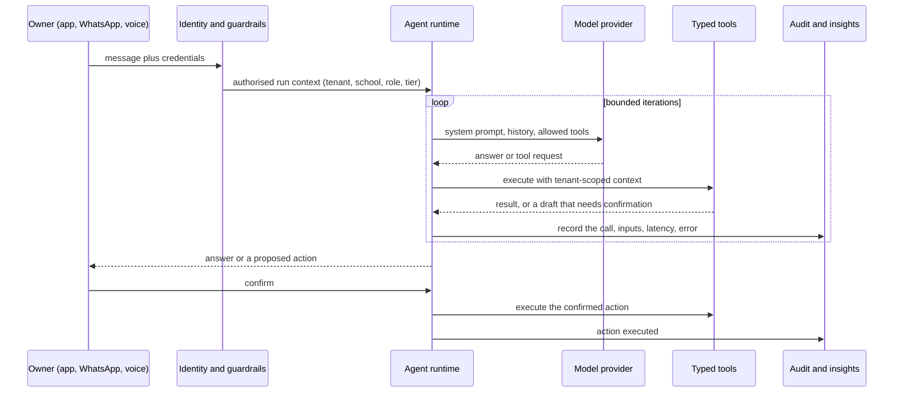
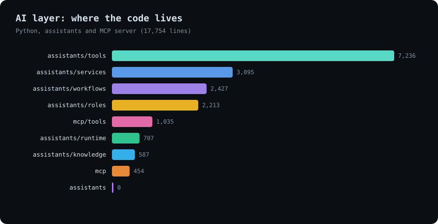
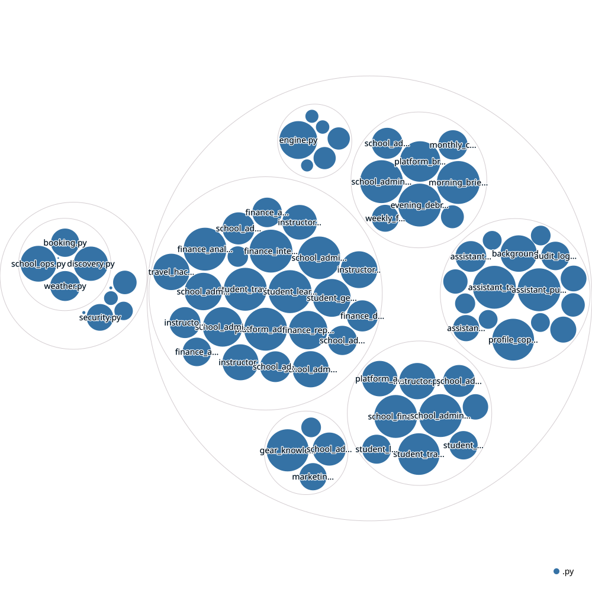

# AllyOS: assistants, MCP and voice

*Architecture note. This is a layer inside AllyOS, not a separate product.*

**An agent layer that operates a business through chat. Role-based assistants call typed, audited, tenant-scoped tools from the app, from WhatsApp and Telegram, by voice, from any MCP client, and on a schedule.**

*Source is private. This page documents the architecture and how it is made safe.*

---

## The product

A school owner can ask "which clients are missing waivers for tomorrow?", "what is overdue and how much cash is coming in?" or "draft a reminder to everyone with an unpaid invoice", in the app, on WhatsApp, or by voice, and the assistant answers from live data, proposes an action and waits for a yes.

<!-- TODO: replace with real captures -->
| School ops chat | Insight feed with accept and dismiss | WhatsApp conversation |
|---|---|---|
| _screenshot_ | _screenshot_ | _screenshot_ |

---

## Where it can be reached

| Surface | What it is | Auth |
|---|---|---|
| **In-app chat** | Role-specific chat tabs for school operations, marketing and finance, an instructor assistant, three rider assistants (travel, learning, gear) and a platform-admin command center | User session |
| **WhatsApp and Telegram** | Inbound webhooks route a message from a known user through the same assistant and reply on the same channel | Provider signature verified; fails closed if the secret is missing |
| **Voice** | Two conversational voice agents (school admin and rider travel) that call the same tool handlers as webhooks | Shared secret plus an expiring, HMAC-signed school-context token |
| **MCP server** | Platform tools for spot and school discovery, booking availability and school operations, for any MCP client | Signed school token; the one write tool needs explicit confirmation |
| **Scheduled workflows** | Morning briefing, evening debrief, daily finance report, weekly finance digest, month-end close, inventory readiness, compliance check, revenue recovery, content and distribution plans | Server-side, per tenant |

One runtime sits behind all five.

---

## Architecture

<picture>
  <source media="(prefers-color-scheme: dark)" srcset="../../assets/allyos-assistants/architecture-dark.svg">
  
</picture>

[Open the interactive diagram](../../assets/allyos-assistants/architecture.html)

---

## How it is engineered

**One bounded agent loop.** The runtime receives an authorised run context and a message, calls the model with the tools allowed for that role and tier, executes tool requests, feeds results back, and stops at an answer or a maximum number of iterations. It always returns something useful: if the step limit is hit, it says so and summarises what it found.

**Typed tools over tenant-scoped data.** Roughly a hundred tools across eight roles, grouped by what they do: finance (receivables, payables, daily, analytics, intelligence, reporting), school admin (core, finance, inventory, marketing, notification, support, tasks), instructor (schedule, students, income, conditions), rider (gear, learning, travel) and platform admin. Each handler receives the same run context, so every query is scoped to the caller's tenant and school.

**Read, draft, write.** Tools are classified by intent. Reads run freely. Drafts return the proposed text, the action type and the payload with a confirmation flag, and nothing happens until the user accepts. Confirmed actions are queued and executed as separate audited events.

**Tiers.** A free guide tier can explain features and check setup progress with no access to live data; the pro tier unlocks live data, drafts and workflows. Tier decides the tool set, the model size and the daily message limit, and the free tier's system prompt tells the model what it cannot do.

**Failure never corrupts the run.** A tool error is returned to the model with a hint to answer from general knowledge and say the live data was unavailable, and the database session is rolled back so the conversation stays usable. Audit writes can fail without breaking the assistant.

**Everything is recorded.** Each run stores tenant, user, role, trigger, tool calls, latency and errors. A structured audit log keeps tool calls and errors, chat requests and responses, insights created, accepted and dismissed, approvals requested, actions queued and executed, and outbound messages.

**Memory and plans.** Per-user memory notes (what the admin cares about, dismissed topics, patterns, accepted suggestions) are injected into the system prompt at the start of a conversation. The assistant can also create multi-step plans from chat or templates, with ordered tasks the admin works through.

**Heavy work runs off the chat path.** Long workflows run as background jobs (queued, running, completed or failed) so chat stays fast, and results arrive as insights and push notifications.

**Proactive, but polite.** Insights are pushed only if the user opted in, the priority meets a threshold, quiet hours are respected, the daily limit is not exceeded, and a duplicate of the same insight for the same school in the last 24 hours is suppressed.

**A model provider behind an interface.** The SDK call is isolated in one module so the provider can be swapped or mocked, and tools can come from several sources through a small protocol (local registry today, an MCP tool source designed for later).

---

## The MCP server

- **Tools:** discovery (spots, destinations, schools, best-destination matching, trip cost estimate), booking (services, availability, vouchers) and school operations (overview, bookings needing attention, overdue invoices, clients missing documents, setup checklist, cashflow, margin leaks, inventory health and inspections, uninvoiced sessions).
- **Transports:** stdio for local clients. A streamable HTTP transport is built and mounted inside the API, and is **deliberately switched off by default**: the school tools still take their credentials as parameters, which is unsafe on a public endpoint, so it stays off until transport-level identity (OAuth) replaces them. The older SSE transport is development-only and enabled only with an API key.
- **Guardrails on every call:** per-session rate limits (per minute and per hour), a hard cap on list results, a field allowlist on public data so records cannot be scraped wholesale, audit logging with credentials stripped from parameters, and a confirmation parameter that every write tool must carry (today the single write tool creates a support ticket).
- **Same identity as voice.** Signed, expiring school-context tokens are shared between the voice agents and the MCP server, so one mechanism proves who is calling.
- **A dev-mode bypass** exists only when a secret is configured and supplied, and logs when used.

---

## Stack

| Layer | Technology | Why |
|---|---|---|
| Runtime | Python, FastAPI, Pydantic dataclasses | Same service as the platform, same tenant context |
| Model access | Anthropic SDK behind a provider module | Swap, mock and tier the model in one place |
| Tool protocol | Local registry plus a `ToolSource` protocol; MCP server on the official Python SDK | Tools reusable across chat, voice and external clients |
| Channels | Twilio (WhatsApp), Telegram Bot API, ElevenLabs Conversational AI, FCM push | Meet users where they already are |
| Jobs | Background thread jobs and a scheduler loop | Keep chat under a few seconds |
| Storage | Postgres tables for runs, insights, memory, plans, preferences and the audit log | Queryable history of every agent action |
| Security | HMAC-signed expiring tokens, shared secrets, webhook signature checks, rate limits, field allowlists | Defence at every entry |

---

## Key design decisions

| Decision | Trade-off |
|---|---|
| Tools are the only way the model touches data | More engineering per capability, but the model cannot invent access and every action is attributable |
| Draft first, execute after confirmation | One extra step for the user, but no assistant ever changes money, messages or records on its own |
| Tool intent set by name prefix and confirmation flag | Simple and visible, but relies on naming discipline (an allowlist would be stricter) |
| One runtime for chat, WhatsApp, voice and scheduled jobs | A single surface to secure and test instead of five |
| Public MCP over HTTP stays off until OAuth | Slower to ship remote access, but no credential ever passes through a model's context |
| Free tier cannot read live data | Clear upgrade path, and the cheaper model never touches sensitive records |

---

## Build status

| Area | Progress | |
|---|---|---|
| Agent runtime, audit and run history | `▰▰▰▰▰▰▰▰▱▱` 85% | Loop, tiers, audit, memory, plans, jobs built |
| Roles and tools | `▰▰▰▰▰▰▰▰▱▱` 75% | Eight roles, 100+ tools; more actions coming |
| Proactive insights and push guardrails | `▰▰▰▰▰▰▰▰▱▱` 80% | Opt-in, quiet hours, limits, de-duplication |
| WhatsApp and Telegram | `▰▰▰▰▰▰▱▱▱▱` 60% | Inbound routing and signature checks built |
| Voice agents | `▰▰▰▰▰▰▱▱▱▱` 60% | Tool webhooks and signed context built |
| MCP server over stdio | `▰▰▰▰▰▰▰▱▱▱` 70% | Discovery, booking, school ops tools |
| MCP over HTTP | `▰▰▰▱▱▱▱▱▱▱` 30% | Built and tested, off by default until OAuth |
| MCP as a tool source for the runtime | `▰▱▱▱▱▱▱▱▱▱` 10% | Interface designed, client not implemented |
| Automated tests | `▰▰▱▱▱▱▱▱▱▱` 15% | Transport tests exist; runtime and tool tests to add |
| Answer-quality evaluation | `▱▱▱▱▱▱▱▱▱▱` 0% | Not yet built |

*Percentages are estimates against the intended scope.*

---

## Size and structure

| Part | Lines of code |
|---|---|
| Assistant runtime, roles, tools, workflows, services, knowledge | ~16k |
| MCP server and tools | ~1.6k |
| Chat, webhook and voice endpoints | ~2.8k |

~21k lines of Python.

| Where the code lives | Structure map |
|---|---|
|  |  |

---

## Status

Active development. Open to licensing, partnership and consulting.

**Contact:** [antigravityalliance.com](https://antigravityalliance.com) · [dev@allyos.app](mailto:dev@allyos.app) · +27 76 931 7108
