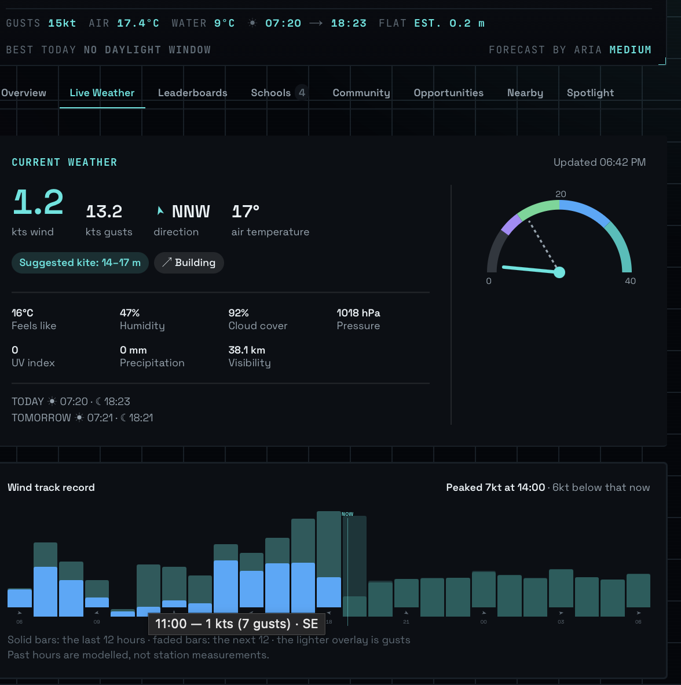
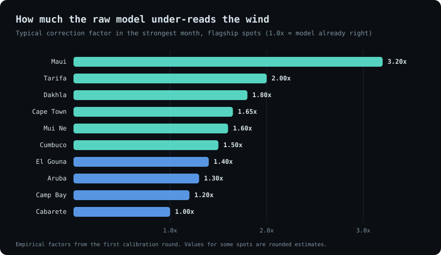
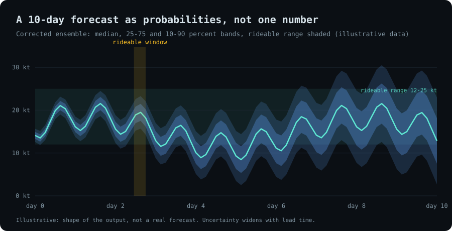
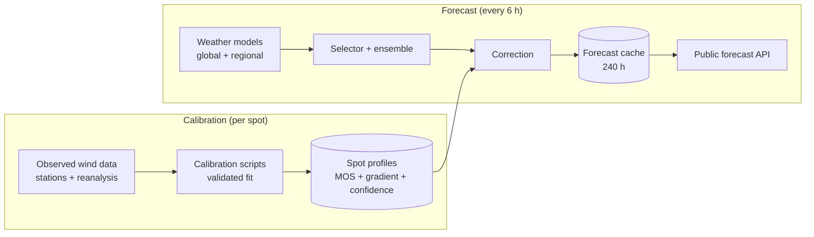

# ARIA

**Wind forecasts that are calibrated to the spot, not to the model. A per-location correction engine for kite, wing and wind sports.**

*Source is private. This page documents the model and how it is engineered.*

---

## The product

*The live weather tab of a spot page: calibrated wind, gusts and direction, a suggested kite size, a trend marker ("Building"), a gauge, and a 24-hour wind track with the next 12 hours faded in. The header shows the forecast source and its confidence tier ("Forecast by ARIA, Medium"), and the chart is honest about itself: "Past hours are modelled, not station measurements."*

**White-label by design.** One deployment serves many hosts. Each school, brand or service provider gets its own name, logo and colour tokens, so the same weather and booking experience appears in the provider's own look.

| What the correction does | What a forecast looks like |
|---|---|
|  |  |

---|---|---|
| _screenshot_ | _screenshot_ | _screenshot_ |

---

## The problem

Global weather models see the world in grid squares of 10 to 30 km. A kite spot lives in the details they cannot resolve: a strait that funnels the wind, an isthmus between two mountains, a coastline that heats and pulls the sea breeze in. The result is a forecast that is confidently wrong in the same direction every time. At some of the best spots in the world, the raw model reads a third of the wind a rider actually gets.

A rider planning a trip or a lesson needs one answer: **will it be rideable, and how sure are you?**

## What ARIA does

ARIA takes the raw output of the world's weather models and corrects it for each individual spot, using what actually happened there.

- **A per-spot, per-month correction** fitted from years of real observations, so a spot where models always under-read gets corrected upward by the right amount in the right season.
- **A gap-wind term** for spots where wind is squeezed through a terrain constriction by a pressure difference, which no monthly factor can capture.
- **Probabilities, not a single number.** Every hour carries the share of ensemble members that land in the rideable range, plus the 10th, 50th and 90th percentile wind.
- **Rideable windows.** Consecutive hours in the usable wind range are grouped into sessions and graded by peak.
- **Front detection** from pressure falls and wind shifts, so a coming change is flagged early.
- **Honest confidence.** Every corrected number carries a confidence tier that says how it was calibrated. Spots with no calibration are labelled "raw" in the apps instead of being passed off as ARIA.

---

## How a forecast is made

[Explore the interactive diagram](../../assets/aria/architecture.html)

**Corrected wind = ensemble member × monthly factor + gap-wind delta.** The gap-wind term is fitted on what the monthly factor still gets wrong, so the two corrections never double-count. It is additive on purpose: terrain acceleration adds wind the model does not have at all, and multiplying a near-zero model wind would stay near zero.

---

## Why it is hard to copy

The method is standard practice. The advantage is everything built on top of it.

- **A calibration asset that only grows.** Each spot's correction comes from years of observed wind matched to model output. That history cannot be downloaded in a weekend, and every new season and every new spot makes the set more valuable.
- **Ground truth chosen for each spot.** Knowing which observation source represents a spot, and when it does not, is hard-won local knowledge baked into the profiles.
- **A validation habit.** Corrections that cannot prove themselves on unseen data are switched off, so the numbers can be trusted at scale and extended safely.
- **Distribution.** ARIA sits inside a booking platform that schools and brands already use, so it is calibrated where riders actually book, not across an academic grid.
- **Integration depth.** The forecast feeds booking, gear recommendations and brand sites through one calibrated source, so improving ARIA improves every product at once.

The profiles, fitted values and station choices are the private part, and are shared only under agreement.

---

## The engineering

**Model selection by location.** Regional high-resolution models only cover their own region, and asking them about somewhere else returns nothing useful. ARIA resolves which models apply to a spot *before* fetching, from its coordinates: a continental US, a Canadian, a European or a global model set. Selection is a pure function with no I/O, tested exhaustively. Border overlaps are documented and the known edge cases are written down, not hidden.

**Real ensembles, not single runs.** Two global ensembles (roughly 80 members between them), with an extra regional model added in Canada and Europe. Every member is corrected individually, then turned into probabilities and percentiles.

**Raw regional data where the aggregator stops.** For the US, ARIA also pulls rapid-refresh and high-resolution-window models straight from the national weather service as raw GRIB files, subset to a small box and decoded locally. It fetches only a fixed set of near-term hours per spot and respects the provider's fair-use limits.

**Calibration you can audit.** For each spot the pipeline finds the nearest observation station within a set radius, pulls three years of observed hourly wind and the matching reanalysis, and computes the median monthly factor. Each month is checked against sanity bounds. Confidence is tiered by distance to the station and by how many months were rejected; if too many months fail, the spot is skipped entirely instead of shipping a weak number.

| Confidence | Meaning |
|---|---|
| **HIGH** | Hand-curated, or a station very close to the spot |
| **MEDIUM** | A nearby station |
| **LOW** | A more distant station, or downgraded after rejected months |
| **NONE** | No calibration: served as raw model output, labelled as such |

**Validated before it is allowed to act.** The gap-wind fit is tested on the most recent twelve months it never saw. If it does not beat the monthly-factor-only baseline by the required margin, it is stored as inert and changes nothing. A correction nobody validated does not ship.

**Operated like a service.** A scheduler regenerates every calibrated spot every six hours. A failing spot is recorded with an error count and does not block the others. Provider call budgets are computed and written down. Calibration commits propagate to the running app without a restart, through a short-lived cache, with the brief inconsistency window documented and accepted.

**Tested.** 141 test functions across the model selector, the correction service, the gap-wind service and schema, the raw-data service, the regeneration job and the forecast pipeline.

---

## Where it shows up

- **Spot pages** in the booking platform: calibrated live wind, a 10-day forecast, and monthly wind profiles.
- **Brand and shop sites** that embed a spot card with the forecast, labelled ARIA or raw depending on whether the spot is calibrated.
- **Gear recommendations:** the gear prescription uses ARIA's seasonal wind statistics to suggest kite sizes for a spot and month.
- **The live weather layer**, where every wind reading passes through the same calibration, with a confidence tier in the response and a raw passthrough for uncalibrated spots.

---

## Build status

| Area | Progress | |
|---|---|---|
| Calibration pipeline (stations, reanalysis, bounds, tiers) | `▰▰▰▰▰▰▰▰▰▱` 90% | Built, tested, idempotent |
| Forecast engine (ensembles, probabilities, windows, fronts) | `▰▰▰▰▰▰▰▰▰▱` 90% | Running on a six-hour schedule |
| Regional high-resolution models | `▰▰▰▰▰▰▰▱▱▱` 70% | Selector and raw-data service built; more regions to come |
| Gap-wind correction | `▰▰▰▰▱▱▱▱▱▱` 40% | Service, schema and fitting tool built; per-spot fits are the next step |
| Spot coverage | `▰▱▱▱▱▱▱▱▱▱` 10% | Hundreds of spots calibrated today; extending to the major riding hubs worldwide is the current plan |
| Published accuracy report | `▰▱▱▱▱▱▱▱▱▱` 10% | Held-out validation exists for the gap-wind term; a public skill report is planned |

*Percentages are estimates against the intended scope.*

---

## Size and structure

| Part | Size |
|---|---|
| Services, models and API | ~1.4k lines |
| Calibration and forecast scripts | ~2.6k lines |
| Tests | 141 test functions, ~1.7k lines |
| Design and engineering docs | 4 documents, ~2k lines |

<!-- TODO: structure.svg -->

---

## Status

Active development. Open to licensing, data partnerships, integration with other sports platforms, and consulting.

**Contact:** [antigravityalliance.com](https://antigravityalliance.com) · [dev@allyos.app](mailto:dev@allyos.app) · +27 76 931 7108
