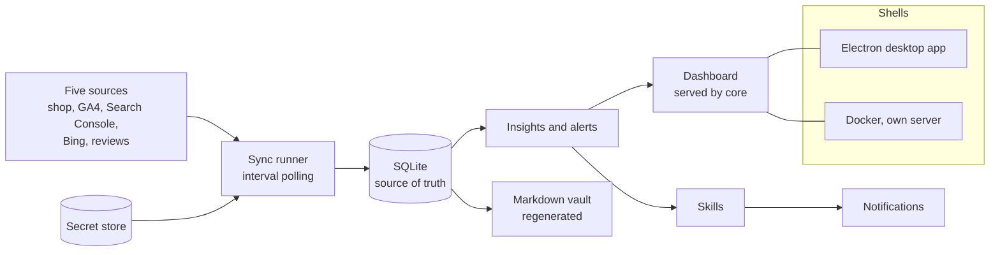
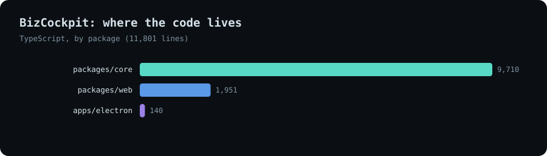
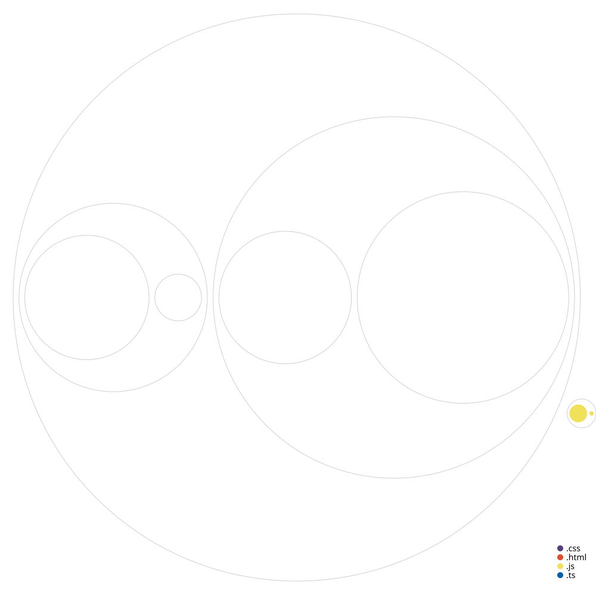

# BizCockpit

**The owner's management dashboard for a small or medium-sized brand: sales, stock, traffic, search, reviews and alerts from one place, running on hardware the owner controls.**

*Source is private. This page documents the product and how it is built.*

---

## The product

<!-- TODO: replace with real captures -->
| Overview | Sales for one day | Products and stock status |
|---|---|---|
| _screenshot_ | _screenshot_ | _screenshot_ |

| Growth (search and traffic) | Needs attention | Settings and source health |
|---|---|---|
| _screenshot_ | _screenshot_ | _screenshot_ |

---

## What it is

Running a small or medium-sized brand means opening a different tool for sales, stock, traffic, search and reviews. BizCockpit puts the owner's numbers in one dashboard, keeps their history, and tells them when something needs attention. It is **read-first**: it reports and alerts, and does not publish, spend or write back to the shop.

**Who it is for.** An owner or operator who wants full control and an overview of the business from one place, without handing the data to another vendor.

**What the owner sees**
- **Overview:** the last 7, 30 or 90 days against the same-length period before, key figures with sparklines, a daily chart where a click on any day opens Sales for that day, a monthly revenue goal if set, an attention strip (at most three items, then "+N more") and a freshness dot per source.
- **Sales, Products and Growth screens:** sales, every SKU with a stock status, and traffic and search performance.
- **Inventory status that does not lie.** Quantity alone misleads (a sold-out item and a made-to-order item both read zero), so each SKU gets a status from four facts: listed, stock tracked, units on hand, and whether it sells past zero. The states are Low, Sold out, Sells at 0, In stock, Not tracked and Not listed, and the dashboard filters by them.
- **Skills that watch for the owner:** a morning brief that narrates the numbers across sources, cross-source alerts (visits with no orders, ad spend with no sales, week-over-week traffic or search drops, new low-star reviews, a source failing three times in a row), and a stock alert for items newly low or sold out. Each alert is announced once.

---

## Architecture

<picture>
  <source media="(prefers-color-scheme: dark)" srcset="../../assets/bizcockpit/architecture-dark.svg">
  
</picture>

[Open the interactive diagram](../../assets/bizcockpit/architecture.html)

**One core, two shells.** The core engine (database, connectors, vault, skills, scheduler, HTTP API) is deployment-agnostic and serves the dashboard as static files. A thin Electron shell spawns it for non-technical owners; a Docker shell runs it on the owner's own server. The same UI is used in both.

---

## How it is engineered

**Local-first, no vendor holds the data.** The owner's history lives in a SQLite file on their laptop or their own server. That is also the product's pitch to an owner who does not want another vendor sitting on the numbers.

**Sources are one list, polled by interval.** Each source declares its keys and a polling interval (not a cron), so a laptop that slept catches up on launch. Every attempt is written to a sync-runs table; an unconfigured source is skipped without a failure row. Shop data syncs every 30 minutes; analytics, search, Bing and reviews every six hours.

**Graceful when access is missing.** Before each request the shop sync checks the scopes the app was granted, so a missing one shows as a clear "skipped: app is missing this scope" instead of a raw error, and each entity syncs independently so one gap never aborts the rest.

**Unattended means robust.** Google analytics and search use a service account, not OAuth, because an OAuth client left in testing status issues refresh tokens that expire after seven days, which would silently silence an unattended cockpit.

**Secrets handled properly.** On a Mac keys sit in the system keychain, written over stdin so they never appear in a process list; on a server they sit in an AES-256-GCM encrypted file keyed by a master key. A command-line tool takes secrets through a hidden prompt, so a key is never pasted into a chat or committed.

**Safe on the desktop, being hardened on a server.** The desktop shell binds to loopback only and checks the host and same-origin on every write, which blocks DNS rebinding and cross-site requests. The server shell uses an admin password stored as a bcrypt hash with a session cookie. Refusing to start with an unsafe configuration, signed and expiring sessions and login back-off are designed and planned.

**The database is treated as the only copy.** Schema changes are versioned, append-only migrations guarded by the database's own version pragma, run inside a transaction, with a backup taken before any run that changes the version. Backups use a consistent single-file snapshot even while a sync is in flight, and restore is tested including rollback and damaged-file detection.

**Skills are small and read-only.** A skill is one module with a trigger (schedule, event or manual) and a context that has read access to the database, a vault writer and a notifier, and no write-capable external client. The language-model skill calls the API directly with a per-skill monthly budget, a pre-call cost estimate that refuses rather than overspends, and spend recorded per run. Without a key the morning brief falls back to plain numbers.

**A vault that can always be rebuilt.** SQLite is the source of truth; an Obsidian-compatible markdown vault is regenerated from it after every sync. Machine-owned parts are overwritten, the owner's own prose below a marker is never touched, and a note missing the markers gets a fresh block appended instead of a guess.

**An honest interface.** Unknown is not zero: unknown days are gaps in a chart, a known zero is drawn, and a "history starts" marker replaces any line before data exists. Every chart has a text summary and a hidden data table, and colour is never the only signal.

---

## Stack

| Layer | Technology | Why |
|---|---|---|
| Core | TypeScript on Node | One language across engine, UI and shells |
| Data | SQLite (better-sqlite3) with Drizzle ORM | One file per business; fits single-business volumes |
| UI | Plain TypeScript, static HTML and CSS, inline SVG charts | No framework or chart library; works offline |
| Desktop | Electron | A thin shell that spawns the core and opens a window |
| Server | Docker and Compose | Self-hosting on the owner's own VPS |
| AI | Direct Anthropic API call, budget-guarded | One fetch call, no SDK dependency |
| Secrets | macOS keychain via the system tool; AES-256-GCM file elsewhere | No native module to rebuild |
| Quality | Vitest, TypeScript, pre-push gate | 174 test cases across 23 files |

---

## Key design decisions

| Decision | Trade-off |
|---|---|
| Local-first, not hosted | A closed desktop app cannot sync, so every launch catches up first; the server shell is designed to add webhook delivery |
| Read-first, no write-back | The owner does the acting, but nothing irreversible can happen by accident |
| One SQLite file per business | Simple and portable; a multi-business operator would add a fleet layer later |
| Service account over OAuth for Google | A little more setup once, no weekly token expiry |
| Skills as modules, not a workflow engine | Less flexible, far less to maintain for a small team |
| Social publishing and ad spend: integrate, never build | Keeps the product away from irreversible, cost-bearing actions |
| Generic tables with a source column | Naming costs nothing now and avoids migrating data that will live on other people's machines |

---

## Build status

| Area | Progress | |
|---|---|---|
| Shop sync, overview, sales, products and stock status | `▰▰▰▰▰▰▰▰▱▱` 85% | Built and tested; abandoned-checkout paging still open |
| Search, analytics and reviews sources | `▰▰▰▰▰▰▰▰▱▱` 80% | Five sources wired |
| Skills and alerts | `▰▰▰▰▰▰▰▱▱▱` 70% | Morning brief, cross-source alerts, stock alert |
| Storage, migrations, backup and restore | `▰▰▰▰▰▰▰▰▱▱` 85% | Tested including rollback |
| Server shell reachable and safe | `▰▰▰▰▰▱▱▱▱▱` 50% | Password mode works; public access and session hardening planned |
| Finance (accounting integration) | `▰▱▱▱▱▱▱▱▱▱` 10% | Designed, a connector scaffold exists |
| Social (read-only reporting) | `▰▱▱▱▱▱▱▱▱▱` 5% | Designed |
| Desktop installer, updates, licensing | `▰▱▱▱▱▱▱▱▱▱` 10% | Planned |
| Multi-business operator kit | `▰▱▱▱▱▱▱▱▱▱` 5% | Designed, deferred until a second business is signed |
| Windows support | `▱▱▱▱▱▱▱▱▱▱` 0% | Planned |

*Percentages are estimates against the intended scope. There is no CI yet; a pre-push gate runs the type check and tests before anything reaches the main branch.*

---

## Size and structure

| Part | Lines of code |
|---|---|
| Core engine (TypeScript) | ~6k |
| Dashboard UI | ~2k |
| Tests | 23 files, 174 cases |
| Total TypeScript | ~12k across 87 files |

| Where the code lives | Structure map |
|---|---|
|  |  |

*Structure map: circle size is file size, colour is file type. Folder and file names only.*

---

## Status

Active development, about a month of history. Open to licensing, partnership and consulting.

**Contact:** [antigravityalliance.com](https://antigravityalliance.com) · [dev@allyos.app](mailto:dev@allyos.app) · +27 76 931 7108
