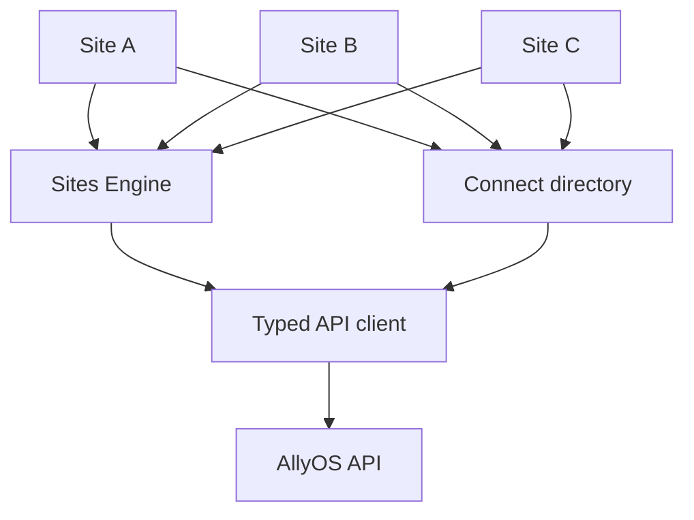

# Sites Engine + Connect

Two shared layers that let one platform power many branded sites.

- **Sites Engine:** host to tenant routing, typed client, themes and layout archetypes, section components with variants, Shopify cart bridge.
- **Connect:** directory layer for spots, schools and shops: a globe-based explorer, tabs, region filters and detail cards. Each site supplies only style tokens.

Shipped as TypeScript source packages consumed by monorepos.

## Size
Sites Engine ~1.8k LOC (63 files); Connect ~9.2k LOC (66 files).
