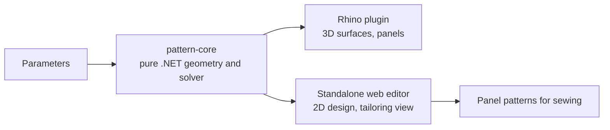

# SoftWing

Parametric design software for soft wings (kites and parawings): define the shape, get a solved, buildable pattern.

## How it is built

[Interactive diagram](../../assets/softwing/architecture.html) (explore, trace paths, light/dark; open after cloning or via Pages).

- **Host-free core:** geometry and solver compile with no CAD dependency, so the same math drives the Rhino plugin and the browser editor.
- **Test discipline:** offline test consoles plus in-Rhino harnesses.
- Runs as an always-on local app.

## Size
~22k lines of C# in total; solver core ~1.3k, Rhino plugin ~5.9k, web editor ~3.5k LOC.
