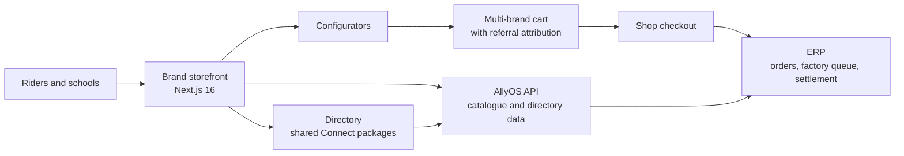
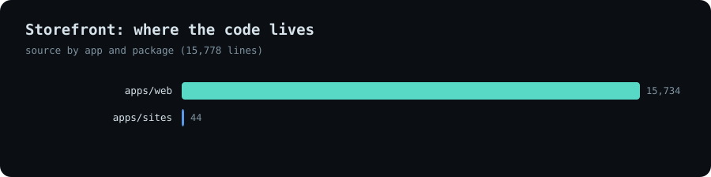
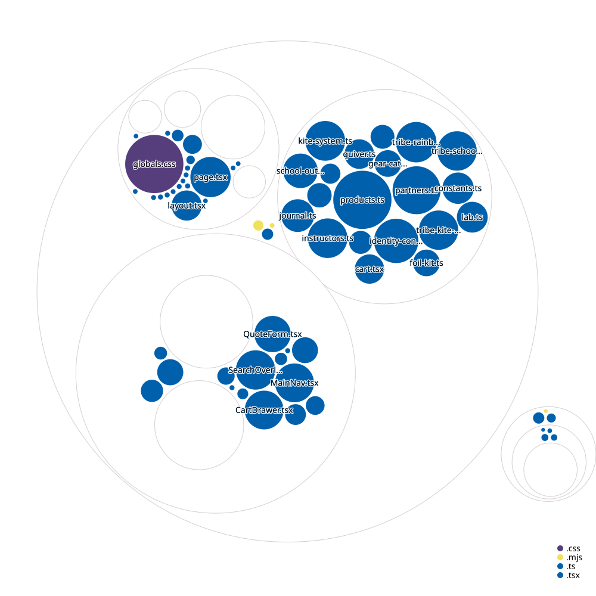

# United Gear

**A direct-to-rider gear brand on its own storefront: product story, configurators, quotes for schools, a live directory and a multi-brand cart, all running on the AllyOS platform.**

*Source is private. This page documents the product and how it is built.*

---

## The product

<!-- TODO: replace with real captures of the live storefront -->
| Home | Product page | Quiver builder |
|---|---|---|
| _screenshot_ | _screenshot_ | _screenshot_ |

| Foil kit builder | Directory map | School fleet and quote |
|---|---|---|
| _screenshot_ | _screenshot_ | _screenshot_ |

---

## What it is

The consumer face of a gear brand that sells directly to riders and through schools. It is also the reference front end for what a brand going direct looks like on the AllyOS platform: the storefront is light, and everything operational sits behind it in the [ERP](../allyos-erp).

**For riders**
- A product catalogue and product pages, gear categories and a journal for the brand's story and education.
- **Configurators** that turn a catalogue into a decision: a quiver builder (choose a set of kites that covers a wind range), a hydrofoil starter-kit builder, and a visual gear blueprint with side-by-side range comparison.
- A cart that works across brands, a search overlay and a quote request for larger orders.

**For schools and shops**
- A school fleet builder and an outfit builder for team kit.
- A white-label merchandise kit builder for schools that want their own branded line.
- Pages for schools and shops, and a partners page.

**For everyone**
- A live directory of spots, schools and shops on an interactive map, with detail pages and a side-panel explorer.

---

## Architecture

<picture>
  <source media="(prefers-color-scheme: dark)" srcset="../../assets/united-gear/architecture-dark.svg">
  
</picture>

[Open the interactive diagram](../../assets/united-gear/architecture.html)

---

## Stack

| Layer | Technology | Why |
|---|---|---|
| Web | Next.js 16 (App Router), React 19, TypeScript 5 | Server rendering for product and story pages |
| Styling | Tailwind CSS 4 plus a hand-built design system | A distinctive brand look, with CSS layers for predictable overrides |
| Cart and checkout | Shared storefront package: one basket per brand, referral resolution | Several brands in one visit, with the referring school kept to checkout |
| Directory | Versioned Connect SDK and UI packages, Mapbox GL | The same directory components used by other sites, styled by tokens |
| Data | AllyOS public API, validated with Zod | Typed responses and a local sample catalogue when the API is absent |
| Tenant sites | Shared sites engine (themes, sections, host routing) | A branded site per school from configuration |
| Monorepo | pnpm workspaces, Turborepo | Storefront, tenant-sites app and shared packages build together |
| Quality | ESLint 9, TypeScript, CI on every change | Typecheck, test and build gates |
| Delivery | GitHub Actions, Vercel | Gated merges and hosted deploys |

---

## How it is engineered

**A thin front end by design.** The storefront owns presentation and decisions. Orders, stock, factory queue, payouts and invoices belong to the ERP, reached through the platform API and the shop checkout, so the front end can change without touching money logic.

**Graceful when the backend is away.** With no API base configured, the storefront falls back to a local sample catalogue, so the site and its configurators work in development, in previews and in demos.

**Shared packages, consumed as versioned artifacts.** The directory components and SDK are published as versioned packages and consumed as pinned tarballs. Upgrades arrive as small, reviewable pull requests (for example "adopt version 0.3.4"), so a shared change cannot silently alter a production site.

**One cart across brands.** Shop checkouts are per store, so the cart keeps one basket per brand and fans out at checkout, attaching the originating site and the referral code to each one. That attribution is what lets the platform settle commission to the referring school or instructor. The cart logic is plain functions with no framework dependency, covered by unit tests in the shared package.

**Configurators are data, not one-off pages.** Each builder reads the same product and range data as the shop, so a catalogue change flows into the quiver, foil kit, merchandise and fleet builders without rework.

**Reviewed delivery.** Work lands through pull requests with CI. Fixes are small and named (for example a CSS reset moved into a layer so utility classes work, or shop cards that linked to the wrong page).

---

## Key design decisions

| Decision | Trade-off |
|---|---|
| Storefront separate from the ERP | Two codebases to coordinate, but the brand can redesign freely and the money path stays in one place |
| Configurators driven by the catalogue | Slightly more modelling up front, but no duplicated product data |
| Shared directory packages instead of copy-paste | A packaging step per release, but every site gets fixes and the same behaviour |
| Local sample data fallback | A little extra data to maintain, but the site never breaks a demo |
| Hand-built design system on Tailwind 4 | More CSS to own, but the brand identity is not template-shaped |

---

## Build status

| Area | Progress | |
|---|---|---|
| Brand site and story pages | `▰▰▰▰▰▰▰▰▱▱` 85% | Home, categories, journal, partner and support pages |
| Directory (spots, schools, shops) | `▰▰▰▰▰▰▰▰▱▱` 80% | Map, side panel, detail pages |
| Configurators (quiver, foil kit, merchandise, fleet) | `▰▰▰▰▰▰▰▱▱▱` 70% | Built on the sample catalogue; live data wiring continues |
| Cart and checkout integration | `▰▰▰▰▰▰▰▱▱▱` 70% | Multi-brand cart and referral built; shop and native checkout paths |
| Live catalogue from the platform | `▰▰▰▰▰▱▱▱▱▱` 50% | Sample catalogue today, API-backed in progress |
| Quotes and white-label requests | `▰▰▰▰▰▱▱▱▱▱` 50% | Request pages and builders in place |
| Automated tests | `▰▰▱▱▱▱▱▱▱▱` 20% | Type checks and build gates in CI; component tests to add |

*Percentages are estimates against the intended scope.*

---

## Size and structure

| Part | Files | Lines of code |
|---|---|---|
| Storefront and tenant sites (TypeScript) | ~97 | ~9.9k |
| Design system (CSS) | 1 | ~5.8k |
| Product, range and story data modules | 20 | ~3k |

~21 public routes · 4 configurators · pull-request workflow with CI.

| Where the code lives | Structure map |
|---|---|
|  |  |

*Structure map: circle size is file size, colour is file type. Folder and file names only.*

---

## Status

Active development. Open to licensing, white-label arrangements for other gear brands, and consulting.

**Contact:** [antigravityalliance.com](https://antigravityalliance.com) · [dev@allyos.app](mailto:dev@allyos.app) · +27 76 931 7108
